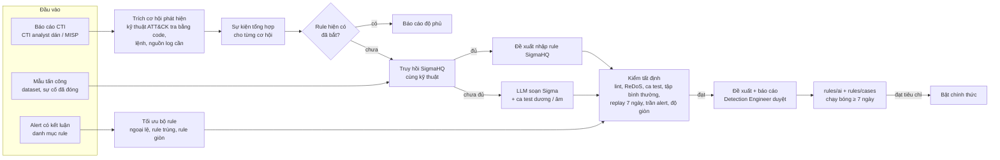

# AI hỗ trợ viết rule: pipeline, dữ liệu và đánh giá

Tài liệu này mô tả toàn bộ phần AI của SOC Platform (`server/siem/ai/`): AI làm gì, dữ liệu lấy từ đâu, rule được sinh và kiểm
định ra sao, kết quả đo các model, và vì sao tỉ lệ đạt còn thấp. Mọi thay đổi về pipeline AI và kết quả thử nghiệm ghi vào
file này; `README.md` chỉ giữ phần tóm tắt.

**Lưu ý về chữ "huấn luyện".** Hệ thống **không huấn luyện hay fine-tune** model nào. Model chạy nguyên trọng số công bố qua
Ollama. Cái được gọi là "huấn luyện" ở đây là một quy trình *học trong ngữ cảnh*: chọn mẫu tấn công và mẫu bình thường, đưa
vào prompt, để model đề xuất chữ ký, đo từng chữ ký trên dữ liệu, hỏi lại model những chỗ còn sót, rồi kiểm định rule cuối trên
dữ liệu model chưa từng thấy. Thứ duy nhất được "nhớ" qua các lần chạy là lý do người duyệt từ chối, được đưa lại vào prompt
lần sau.

**Định dạng rule.** Từ 7/10/2026, model viết rule mới bằng **Sigma** (YAML), định dạng rule phát hiện mở mà model đã gặp hàng
nghìn lần qua SigmaHQ; hệ thống biên dịch rule Sigma sang rule engine của SIEM để đo và chạy (mục 5, 6). Đề xuất ngoại lệ vẫn
dùng JSON schema và DSL của SIEM.

## Mục lục

1. [AI làm gì và không làm gì](#1-ai-làm-gì-và-không-làm-gì)
2. [Toàn cảnh pipeline](#2-toàn-cảnh-pipeline)
3. [Dữ liệu](#3-dữ-liệu)
4. [Chọn ứng viên và gom nhóm](#4-chọn-ứng-viên-và-gom-nhóm)
5. [Prompt và gọi model](#5-prompt-và-gọi-model)
6. [Ghép vế qua nhiều lượt](#6-ghép-vế-qua-nhiều-lượt)
7. [Kiểm định tự động](#7-kiểm-định-tự-động)
8. [Duyệt, triển khai, so sánh với rule hiện có](#8-duyệt-triển-khai-so-sánh-với-rule-hiện-có)
9. [Đo lường và lịch sử chạy thử](#9-đo-lường-và-lịch-sử-chạy-thử)
10. [Đánh giá các model và vì sao tỉ lệ đạt thấp](#10-đánh-giá-các-model-và-vì-sao-tỉ-lệ-đạt-thấp)
11. [Hướng cải thiện](#11-hướng-cải-thiện)
12. [Lệnh chạy và cấu hình](#12-lệnh-chạy-và-cấu-hình)
13. [Nhật ký thay đổi pipeline](#13-nhật-ký-thay-đổi-pipeline)
14. [Nghiên cứu: phương án dùng AI tự động sinh bộ rule](#14-nghiên-cứu-phương-án-dùng-ai-tự-động-sinh-bộ-rule-14102026)
15. [Kế hoạch phát triển AI sinh rule](#15-kế-hoạch-phát-triển-ai-sinh-rule-16102026)

## 1. AI làm gì và không làm gì

AI là trợ lý cho người viết rule phát hiện. Phát hiện vẫn do rule engine chạy trên từng event; AI giúp bộ rule tốt dần lên.

| Bài toán | Dấu hiệu | AI đề xuất |
|---|---|---|
| Giảm nhiễu | Rule có ≥ 3 alert bị analyst đánh dấu báo nhầm trong 30 ngày | Ngoại lệ hẹp cho rule đó |
| Lấp lỗ hổng phát hiện | Mẫu tấn công trong dataset công khai mà chưa rule nào bắt | Rule mới cho loại tấn công / kỹ thuật ATT&CK đó |
| Phủ loại log mới | Nhóm event thật chưa rule nào xem xét | Rule mới, hoặc kết luận "không cần rule" |

Phần LLM làm khá hẹp: nhìn vài mẫu tấn công, vài mẫu bình thường, rồi viết ra chữ ký chung. Mọi bước khác do code tất định và
con người làm. Ngoài phạm vi, có chủ đích: AI không tự triển khai rule (một rule tệ có thể làm ngập alert, một ngoại lệ tệ có thể
làm mù SIEM), không phân loại event theo thời gian thực, và không phát hiện bất thường (phần đó là module ML Isolation Forest,
đang tắt vì báo nhầm cao).

LLM chạy nội bộ bằng Ollama, không publish cổng; log không rời khỏi máy.

## 2. Toàn cảnh pipeline

```mermaid
flowchart LR
    subgraph SRC[Nguồn ứng viên]
      A1[exception<br/>alert báo nhầm]
      A2[gap-dataset<br/>mẫu tấn công chưa bị bắt]
      A3[gap-own<br/>event thật chưa có rule]
    end
    SRC --> P[Chuẩn bị<br/>gom nhóm, tách train / kiểm tra,<br/>mẫu bình thường, rule SigmaHQ tham khảo]
    P -->|prompt| L[LLM qua Ollama]
    L -->|rule Sigma YAML| C[Biên dịch Sigma<br/>sang rule engine, tách vế]
    C --> R[Ghép vế<br/>đo từng vế trên train<br/>và tập bình thường]
    R -->|biến thể còn sót,<br/>vế bị loại kèm lý do| L
    R -->|rule Sigma = OR các vế giữ lại| V[Kiểm định độc lập<br/>tập kiểm tra, báo nhầm,<br/>replay 7 ngày, an toàn]
    P -.->|tập kiểm tra, model không thấy| V
    V -->|đạt| Q[Đề xuất chờ duyệt<br/>console]
    V -->|loại| X[invalid, lưu lý do]
    Q -->|người duyệt| K[Kiểm tra lại với dữ liệu mới nhất]
    K -->|đạt| D[Ghi server/rules/ai/AI-xxx.yml]
```



| File | Vai trò |
|---|---|
| `server/siem/ai/__main__.py` | Vòng lặp worker: chờ lịch (60 phút) hoặc yêu cầu từ console, gọi một chu kỳ |
| `server/siem/ai/worker.py` | Chọn ứng viên, gom nhóm, tách tập, gọi LLM, ghép vế, lưu đề xuất |
| `server/siem/ai/sigma.py` | Đọc rule Sigma của model, biên dịch sang rule engine, tách / ghép vế, xuất YAML Sigma |
| `server/siem/ai/prompts.py` | System prompt (Sigma cho rule mới, JSON schema cho ngoại lệ), cách đưa dữ liệu vào prompt |
| `server/siem/ai/llm.py` | Client Ollama: văn bản (Sigma) hoặc structured output (ngoại lệ), tắt chế độ suy nghĩ, giới hạn token |
| `server/siem/ai/validate.py` | Kiểm định độc lập (không tin model) |
| `server/siem/ai/golden.py` | Nạp dataset, bộ mẫu vàng, tập bình thường, RAG Sigma, báo cáo độ phủ |
| `server/siem/ai/attack_types.py` | Phân loại tấn công web để gom nhóm |
| `server/siem/ai/atomic.py` | Dựng event tiến trình từ bài thử Atomic Red Team |
| `server/siem/ai/endpoint_logs.py` | Đọc và gắn nhãn log endpoint ghi thật (Splunk, OTRF) |
| `server/siem/ai/baseline.py` | Lệnh bình thường tự soạn cho Windows / Linux |
| `server/siem/ai/dataset.py` | Đọc dữ liệu thật của SIEM từ Elasticsearch (chỉ đọc) |
| `server/siem/ai/deploy.py` | Duyệt, kiểm tra lại, triển khai, gỡ |
| `server/siem/ai/benchmark.py` | Báo cáo độ phủ rule trên dataset (`datasets/report.md`) |
| `tools/fetch_datasets.py`, `tools/convert_datasets.py` | Tải và chuyển đổi dataset |
| `tools/bench_ai_models.py` | So sánh model trên cùng pipeline, không lưu đề xuất |

## 3. Dữ liệu

### 3.1 Dữ liệu thật của SIEM

Đọc từ Elasticsearch bằng tài khoản `siem_ai` (chỉ đọc `siem-*`, chỉ ghi `ai-*`):

| Dữ liệu | Dùng cho |
|---|---|
| Alert analyst đánh dấu báo nhầm, alert thuộc case đóng dạng báo nhầm (30 ngày) | Mẫu âm khi đề xuất ngoại lệ |
| Alert thuộc case xác nhận là sự cố thật, kèm event liên quan | Ngoại lệ không được khớp event nào trong số này |
| Event 7 ngày gần nhất (tối đa 200.000) | Chỉ để kiểm định: replay rule mới ra bao nhiêu alert/ngày. Không đưa vào prompt |
| Nhóm event (module / category / action, ≥ 20 event) chưa rule nào xem xét | Nguồn `gap-own` |

Nhãn đúng / sai do analyst gắn qua quy trình case; AI không tự gắn nhãn. Lab có rất ít event thật, nên gần như mọi đề xuất đến
từ dataset công khai.

### 3.2 Dataset công khai

Lưu ở `datasets/` (không đưa vào repo). Nguồn, giấy phép, phiên bản và SHA-256 ghi trong `datasets/SOURCES.md`; bộ nhiều file
ghi SHA-256 từng file trong `datasets/raw/<bộ>/manifest.json`.

| Dataset | Nội dung | Dùng cho |
|---|---|---|
| HTTP DATASET CSIC 2010 (anomalous) | 15.088 request tấn công quan sát được trong access log | Mẫu tấn công web, bộ mẫu vàng |
| HTTP DATASET CSIC 2010 (normal) | 36.000 request bình thường | Đo báo nhầm của rule web |
| Atomic Red Team (MIT, `index.yaml`) | 1.665 bài thử (1.251 Windows, 414 Linux), dựng thành 3.364 tiến trình | Mẫu tấn công endpoint **dựng lại** |
| [Splunk attack_data](https://github.com/splunk/attack_data) (Apache-2.0, 2.011 file, 4,9 GB) | Log **ghi thật** khi chạy tấn công trong Splunk Attack Range: Sysmon, Security 4688, Sysmon for Linux, auditd | Mẫu tấn công thật có nhãn từng event, hoạt động nền thật, đo theo bộ |
| [OTRF Security-Datasets](https://github.com/OTRF/Security-Datasets) (MIT, 323 file, 558 MB) | Log Windows ghi thật khi giả lập tấn công (Empire, Covenant, Metasploit, APT29, Log4Shell) | Đo theo bộ |
| `server/siem/ai/baseline.py` (tự soạn) | 153 lệnh Windows, 152 lệnh Linux bình thường | Chặn rule endpoint quá chung chung |
| SigmaHQ (DRL 1.1) | 3.302 rule cộng đồng | Tài liệu tham khảo trong prompt (RAG) |
| EVTX-ATTACK-SAMPLES (tùy chọn) | Windows event theo tactic | Chưa dùng (cần `python-evtx`, antivirus có thể chặn) |

Dataset chỉ chạy offline qua bộ chuẩn hóa và rule engine, không bơm vào index thật, để không lẫn vào dashboard và không làm SOAR
chặn các IP có trong dataset. Windows Defender chặn 5 file chứa mẫu mã độc (3 của Splunk, 2 của OTRF); các file này được ghi vào
manifest là không đọc được và không bị vượt qua.

### 3.3 Gắn nhãn

**Web (CSIC 2010).** Mỗi request thành một dòng access log Apache như agent gửi. Request POST/PUT có payload trong body bị đánh
dấu "ngoài tầm nhìn" (9.977 mẫu), vì access log không ghi body.

**Atomic Red Team, dựng lại** (`atomic.py`). Mỗi bài thử thành event đúng định dạng agent gửi (Sysmon EventID 1 cho Windows,
`process_creation` cho Linux): 1 tiến trình shell chạy cả khối lệnh và 1 tiến trình con cho mỗi chương trình được gọi. Lệnh nội
bộ của shell và cmdlet PowerShell không tạo tiến trình. Tham số `#{...}` được thay bằng giá trị mặc định. Đây là telemetry dựng
lại từ định nghĩa bài thử: có dòng lệnh, không có hành vi sinh ra sau đó. Bài thử chạy qua công cụ giả lập tấn công cloud
Stratus Red Team bị bỏ. Nhãn mỗi event giữ cả giá trị mặc định của tham số (`lab_values`), để nhận ra tên file bài thử tự đặt
(mục 7, 9.10).

**Log ghi thật** (`endpoint_logs.py`). Chỉ lấy event tạo tiến trình, đọc được XML, văn bản WinEventLog của Splunk, JSON OTRF,
auditd dạng hex và dạng đã giải mã. Hai bộ dữ liệu chỉ ghi kỹ thuật cho cả bộ, nên nhãn từng event được suy ra:
- Thư mục `atomic_red_team` của Splunk: Ansible gọi `Invoke-AtomicTest` qua WinRM. Con cháu của lần gọi chạy bài thử (không kèm
  `-GetPrereqs` / `-Cleanup`), đi qua trình thực thi (`cmd.exe /c`, `powershell.exe & {...}`), là tấn công. Phần còn lại của cây
  điều khiển (WinRM, lớp bọc PowerShell mã hóa lồng 2 lần của Ansible, `sudo ... BECOME-SUCCESS`, `whoami` / `hostname` do
  Invoke-AtomicTest tự gọi, `csc.exe`, `mscorsvw.exe`...) là công cụ thử và bị bỏ.
- Tiến trình ngoài cây là hoạt động nền, nhưng chỉ được nhận là bình thường khi xuất hiện ở ít nhất 2 kỹ thuật khác nhau. Lý do:
  tấn công chạy ngoài cây (mở file `.chm`, mã độc giả danh `splunkd.exe`) từng lọt vào tập nền.
- File đã được lọc sẵn (auditd, một số file nhỏ): event khớp lệnh bài thử Atomic cùng kỹ thuật (≥ 60% token) là tấn công;
  auditd thì mọi tiến trình là tấn công; còn lại chỉ dùng đo theo bộ.
- Thư mục khác của Splunk và toàn bộ OTRF: chỉ đo theo bộ.

| Tập sau khi gộp trùng | Số tiến trình |
|---|---|
| Tấn công thật, nhãn từng event | 863 (595 Windows, 268 Linux), 70 kỹ thuật; 623 ghép được đúng bài thử Atomic |
| Nền thật (bình thường) | 112 Windows; Linux chưa có |
| Đo theo bộ | 15.421 tiến trình, 168 kỹ thuật (Splunk 479 bộ, OTRF 117 bộ) |

**Tập bình thường endpoint** (từ 9/10/2026, bổ sung 11/10; mục 9.8–9.10). Windows 671 tiến trình, Linux 200:
- **Lệnh tự soạn** (`baseline.py`: 153 Windows, 152 Linux): lệnh hệ thống, quản trị, cài đặt, sao lưu, lập trình. Có cả công cụ
  "hai mặt" ở dạng vô hại (`reg add`, `rundll32` mở Control Panel, `certutil -hashfile`, `msiexec /V`, `hh.exe` mở file trợ
  giúp, `find / -perm -4000` khi kiểm tra bảo mật) và lệnh bọc shell. Riêng phần "hoạt động của con người" thêm 8/10: cài đặt
  qua GPO / SCCM, Teams ghi Run key, script trong thư mục Startup, lập trình viên tải từ GitHub (`curl ... | bash`), quản trị
  PowerShell / AD (`Test-Path`, `Copy-Item`, `Get-ADUser`), cron có `2>/dev/null`. Thêm 11/10 sau khi rule rộng lọt khi chạy
  thật: `systemctl daemon-reload` / `enable`, `su`, `nohup`, `useradd` / `usermod` / `pw`, `touch /tmp/...`, `chown root`, script
  quản trị chạy qua `powershell -Command "& {...}"`.
- **112 tiến trình nền Windows ghi thật** từ thư mục `atomic_red_team` của Splunk (lặp ở ≥ 2 kỹ thuật).
- **Nền ghi thật từ các bộ đo theo bộ** (`golden.scenario_background`: 406 Windows, 48 Linux): dòng lệnh đã chuẩn hóa lặp ở ≥ 3
  kỹ thuật, bỏ dấu vết công cụ thử, bỏ lệnh trùng mẫu tấn công.

## 4. Chọn ứng viên và gom nhóm

Mỗi chu kỳ (60 phút, hoặc khi bấm *Chạy phân tích AI ngay*) tạo tối đa 5 đề xuất. Mục tiêu đang có đề xuất chờ duyệt hoặc đã
triển khai thì bỏ qua. Rule bị người từ chối thì mục tiêu đó bị chặn 30 ngày. Rule bị kiểm định tự động loại thì chỉ bị chặn khi
vẫn cùng model, cùng prompt và cùng phiên bản logic (`GENERATOR_REVISION` trong `worker.py`); đổi một trong ba thì thử lại ngay.

**Web.** Mỗi mẫu được gán một loại tấn công bằng heuristic thô (`attack_types.py`), chỉ để gom nhóm (≥ 10 mẫu mỗi nhóm). Các
loại "riêng ứng dụng" (tham số lạ, giá trị sai định dạng, đường dẫn không tồn tại; 8.266 mẫu) chỉ được báo cáo, không giao cho AI,
vì chữ ký cho chúng chỉ khớp ứng dụng mẫu của CSIC; muốn bắt cần mô hình hành vi hoặc allowlist theo từng ứng dụng. Dấu nháy đơn
lẻ giữa chữ (tên riêng như `D'estats`, hoặc dataset chèn nháy ngẫu nhiên) không tính là SQLi, vì không viết được chữ ký chung mà
không báo nhầm tên người hay địa chỉ hợp lệ. Mỗi mẫu có thêm biến thể (kiểu con trong cùng loại, vd SQLi `tautology-quoted` /
`quote-breakout`, hay thư mục bị dò `/_vti_bin/`) và payload (đoạn làm request bị nghi vấn). Chuỗi giữ chỗ `INJECTED_PARAM` của
CSIC bị bỏ khỏi payload, và rule chứa nó bị kiểm định loại.

| Loại | Mẫu rule hiện tại chưa bắt | Giao cho AI |
|---|---|---|
| Dò file sao lưu / mã nguồn | 2.615 | có |
| Dò tài nguyên nhạy cảm / mặc định | 885 | có |
| CRLF / chèn header | 540 | có |
| Mã hóa né tránh | 466 | có |
| SQL Injection (dạng rule bỏ sót) | 392 | có |
| Server-Side Include | 265 | có |
| Riêng ứng dụng | 8.266 | không |

**Endpoint.** Gom theo kỹ thuật ATT&CK theo hệ điều hành (`windows-T1003` và `linux-T1003` là hai nhóm); dữ liệu dựng lại và log
thật là hai nhóm riêng. Kỹ thuật con có ≥ 4 bài thử chưa bị bắt thành nhóm riêng (vd `windows-T1218.011` Rundll32), phần còn lại
ở nhóm kỹ thuật gốc; nhóm kỹ thuật con được giao trước. Biến thể là chương trình chính của bài thử (`rundll32.exe`, `reg.exe`,
`powershell Set-ItemProperty`). Hiện có 159 nhóm từ dữ liệu dựng lại (81 nhóm kỹ thuật con) và 27 nhóm từ log thật (14
nhóm kỹ thuật con). Hàng đợi xen kẽ web, Windows, Linux.

**Tách train / kiểm tra.** Web: một nửa số mẫu. Endpoint: một nửa số **bài thử**, xen kẽ trong từng biến thể. Tách theo event thì
tiến trình shell và tiến trình con của cùng một bài thử (gần trùng dòng lệnh) rơi vào hai tập, rule chép lệnh vẫn đạt. Tập kiểm
tra không bao giờ được đưa cho model, kể cả ở bước ghép mẫu.

## 5. Prompt và gọi model

Rule mới được viết bằng **Sigma** (từ 7/10). Lý do bỏ DSL riêng của SIEM (danh sách mệnh đề `{field, op, value}` trong JSON)
cho rule mới, rút ra từ các lần chạy 4–7/10:
- model 7–9B chép nguyên lệnh của mẫu và đưa từ đơn;
- regex đường dẫn Windows viết sai, vì phải thoát `\` hai lần trong JSON;
- DSL chỉ cho OR các mệnh đề đơn, nên không gắn được chương trình với đối số.

Sigma có sẵn những thứ đó:
- `Image|endswith` + `CommandLine|contains|all` trong cùng selection;
- giá trị trong nháy đơn giữ nguyên `\`;
- `not filter` để loại biến thể vô hại.

Và đó là định dạng model đã gặp hàng nghìn lần qua SigmaHQ. Đề xuất ngoại lệ vẫn dùng JSON schema + DSL: chỉ vài mệnh đề neo vào
thực thể, model làm tốt.

- **Dữ liệu đưa vào prompt:** 8 mẫu train trải đều theo biến thể (biến thể đông trước), thống kê biến thể của cả tập train,
  mẫu bình thường cùng chương trình hoặc cùng đường dẫn (vd `reg query` cạnh `reg save`), lý do người duyệt từ chối trước đó.
  Thêm 2 rule SigmaHQ gần nhất (ưu tiên cùng kỹ thuật và cùng nguồn `process_creation` của hệ điều hành đó), đặt trong khối
  YAML riêng **ngoài** khối DATA vì là nguồn tin cậy.
- **Mẫu hiển thị theo tên trường Sigma**, đúng như trong rule SigmaHQ. IP, host, user của dataset là nhiễu nên không đưa vào.

  | Lĩnh vực | `logsource` | Trường Sigma | Ánh xạ sang trường của SIEM khi biên dịch |
  |---|---|---|---|
  | Windows / Linux | `category: process_creation`, `product: windows` / `linux` | `Image`, `CommandLine`, `ParentImage`, `ParentCommandLine`, `User` (Windows thêm `CurrentDirectory`) | `process.executable`; `Image\|endswith: '\reg.exe'` thành `process.name = reg.exe` (log Linux có khi chỉ ghi `cat`, không có đường dẫn); `process.command_line`, `process.parent.*`, `user.name` |
  | Web | `category: webserver` | `cs-method`, `cs-uri-stem`, `cs-uri-query`, `c-useragent`, `sc-status` | `cs-uri-query` so với **cả** `url.query` (thô, còn mã hóa) lẫn `url.decoded`: model viết payload đã giải mã hay còn mã hóa đều khớp; `cs-uri-stem` với `url.path` (chuỗi con / phần cuối thì cả `url.decoded`) |
  | Nhóm event thật khác | `product: siem-xdr` | tên trường ECS như trong mẫu | giữ nguyên |

- **Tập con Sigma được hỗ trợ** (`sigma.py`):
  - selection: map = AND, danh sách giá trị = OR, danh sách map = OR, danh sách từ khóa không gắn trường (web tìm trong URL và
    User-Agent, tiến trình tìm trong dòng lệnh);
  - modifier `contains`, `startswith`, `endswith`, `all`, `re`, `windash`, `cidr`, `exists`, `gt` / `lt`;
  - wildcard `*` `?`; `''` là trường rỗng, `'*'` là trường có giá trị;
  - condition `and` / `or` / `not` / ngoặc / `1 of x*` / `all of x*` / `them`. So khớp không phân biệt hoa thường.
- **Không hỗ trợ:** aggregation (`| count`, `near`), `base64offset`, `utf16le`. Lỗi được báo lại cho model bằng tiếng Anh.
- **Trường log không ghi** (`OriginalFileName`, `Hashes`, `IntegrityLevel`...): trong nhánh OR thì bỏ nhánh đó; trong AND thì
  báo model là rule không bao giờ khớp.
- **Thử bộ biên dịch trên toàn bộ SigmaHQ** (rule do người viết, đủ mọi kiểu cú pháp): dịch được 1.185/1.297 rule
  `process_creation` Windows (91%), 107/110 Linux (97%), 77/83 `webserver` (93%). Phần còn lại dùng trường log không ghi,
  modifier không hỗ trợ, hoặc `detection` đã bị cắt ở 1.500 ký tự khi lưu vào `sigma_rules.jsonl.gz`.
- **Gọi model:** dạng văn bản (`chat_text`), vì grammar JSON của Ollama không áp được cho YAML. Câu trả lời được đọc chặt:
  - lấy khối ```` ```yaml ````, bỏ lời dẫn;
  - đường dẫn Windows trong nháy kép (mã thoát YAML sai) được đổi sang nháy đơn;
  - giá trị không nháy chứa `: ` (`description: ... (ví dụ: svchost)`) được đặt trong nháy;
  - khóa lặp trong một selection (`CommandLine|contains` viết 3 lần) được gộp thành `|all`. Nếu để mặc định, YAML chỉ giữ lần cuối
    và mất ý AND;
  - `condition` không đọc được (biểu thức trên trường viết thẳng vào condition, tên selection sai) được thay bằng OR mọi selection,
    trừ filter. Aggregation `| count` và `2 of` vẫn báo lỗi, vì nghĩa khác hẳn;
  - không đọc được thì hỏi lại 1 lần kèm lỗi.

  Ba bản sửa giữa thêm sau lần chạy thử 8/10 (mục 9.6); 4/5 câu trả lời sai cấu trúc của lần đó giờ đọc được.

  Độ dài vẫn chặn ở 1.024 token. Với nhóm event thật, model có thể trả `no_rule: <lý do>`.
- **Siêu dữ liệu do hệ thống đặt**, không tin model: `id`, `status: experimental`, tác giả, ngày, `logsource` đúng lĩnh vực,
  `level` chỉ `low` / `medium`. Tag `attack.*` gồm mã kỹ thuật lấy từ nhãn dataset, cộng các tag hợp lệ model đưa thêm (tag
  không đúng dạng `attack.tXXXX` / `attack.<tactic>` bị bỏ).
- **Chế độ suy nghĩ** (qwen3, qwen3.5): tắt mặc định (`AI_THINK=false`), vì phần suy nghĩ dài gấp nhiều lần câu trả lời.
- **Chống prompt injection:** nội dung log chỉ nằm trong khối JSON `DATA`, đã cắt ngắn và lọc ký tự điều khiển; system prompt nói
  rõ đó là dữ liệu không tin cậy. Câu trả lời chỉ được dùng sau khi đọc chặt, biên dịch và kiểm định.

## 6. Ghép vế qua nhiều lượt

(`worker._refine`, cho nhóm web và endpoint.)

**Tách vế.** Rule Sigma của model được tách thành các **vế** độc lập (`sigma.atoms`): condition được đưa về dạng tuyển chuẩn theo
selection, mỗi vế là AND của các selection, kèm `not filter` nếu có. Ví dụ `1 of selection_* and not filter` thành
`selection_a and not filter` và `selection_b and not filter`.

**Đo từng vế.** Mỗi vế được biên dịch và đo trên tập train và tập bình thường. Vế chỉ được giữ nếu:
- bắt thêm được tấn công;
- không khớp mẫu bình thường nào;
- không gắn với ứng dụng mẫu hay môi trường thử;
- đủ đặc trưng.

**Tách nhỏ vế bị loại** (`sigma.split`) để cứu phần tốt:
- selection là danh sách map thì mỗi map một vế;
- không thì danh sách giá trị OR dài nhất được tách mỗi giá trị một vế. Ví dụ bỏ `' query '` vì khớp lệnh `reg query` bình
  thường, nhưng giữ `' save '`.

Khi xuất rule, các vế con cùng cha được ghép lại thành danh sách giá trị như cũ.

**Nới vế không khớp mẫu nào** (`sigma.relax`). Lần chạy thử 8/10 cho thấy model hay viết sai cú pháp Sigma theo ba kiểu:
- đặt danh sách lựa chọn dưới `|all` (SQLi: 10 dấu hiệu thành bắt buộc có đủ cả 10);
- `all of selection_*` thay cho `1 of`;
- filter loại luôn cả tấn công (`not sc-status: 200`).

Vì vậy vế không khớp mẫu train nào được thử lại ở các dạng: bỏ filter; từng selection đứng riêng; `|all` đọc thành OR. Nhóm SQLi
từ 22% tập kiểm tra lên 70% nhờ bước này.

**Tổng quát hóa vế đạt** (`sigma.generalize`). Vế đã đạt được thử các bản rộng hơn: bỏ filter, bỏ một selection khỏi vế AND, bỏ một
trường khỏi selection. Bản rộng nhất được giữ nếu vẫn sạch (không khớp mẫu bình thường, đủ đặc trưng, có chữ ký) và vẫn bắt mọi mẫu
train cũ.
- Lý do: ở nhóm dò tài khoản domain, model gắn `AdFind.exe` với đúng đối số của bài thử train và thêm filter loại mọi tiến trình
  powershell, nên bắt 0% bài thử chưa thấy. Sau bước này: 88%.
- `reg.exe` đứng riêng vẫn bị tập bình thường chặn.
- Rủi ro: bước này dựa hoàn toàn vào tập bình thường; tập nhỏ thì rule rộng lọt (mục 9.6).

**Vế phải có chữ ký**: ít nhất một điều kiện trên URL / User-Agent (web) hoặc chương trình / dòng lệnh (endpoint). Mã trạng thái,
phương thức, tài khoản đứng riêng không đủ. Trong test, tổng quát hóa từng rút "`.zip` + mã 200" về chỉ "mã 200".

**Vế chưa kiểm chứng.** Vế của câu trả lời **đầu tiên** không khớp mẫu train nào, nhưng qua mọi kiểm tra an toàn (không khớp mẫu
bình thường, không dấu vết môi trường thử, đủ đặc trưng), vẫn được giữ, tối đa 6 vế.
- Lý do: đó là hiểu biết của model về kỹ thuật, ví dụ `procdump ... lsass` khi tập train chỉ có `comsvcs`. Đây đúng là thứ tập
  kiểm tra đo.
- Bản DSL cũ cũng giữ được những thứ này, nhưng chỉ khi chúng nằm chung một regex với phần khớp train.
- Nếu bản nới của chính vế đó bắt được mẫu, thì đó chỉ là lỗi cú pháp chứ không phải hiểu biết riêng, nên bản gốc không được giữ.
- Lịch sử đề xuất ghi rõ số vế loại này để người duyệt xem kỹ.
- Vế ở lượt bổ sung mà trượt train thì bỏ, vì lượt bổ sung đã dồn vào mẫu cụ thể.

**Vế từ SigmaHQ và lượt kiến thức** (từ 9/10, mục 9.9). Ở lượt đầu, rule SigmaHQ `process_creation` cùng kỹ thuật cũng được
tách thành vế và đo như vế của model. Vế khớp mẫu train thì được giữ như thường. Vế sạch nhưng chưa khớp mẫu train được giữ làm vế
chưa kiểm chứng: tối đa 10 vế gốc và 12 vế tất cả (từ 11/10), chỉ rule chung (không lấy rule chiến dịch / CVE), chỉ cho
endpoint. Ngay sau lượt đầu là
**lượt kiến thức**, hỏi các công cụ / cách làm khác của kỹ thuật mà mẫu chưa có. Lượt này luôn chạy, vì mục tiêu "khớp train" không
thưởng cho kiến thức (mục 9.7). Mỗi vế mang nguồn (`model` / `knowledge` / `sigmahq`), ghi trong `llm.atoms` của đề xuất.

**Lượt bổ sung.** Sau lượt đầu, tối đa `AI_REFINE_ROUNDS` (6) lượt bổ sung hỏi riêng **một biến thể** còn sót nhiều nhất:
- prompt mới, kèm vế đã giữ và vế bị loại (có lý do);
- không kèm câu trả lời cũ, không nêu tên loại tấn công;
- hỏi lại cùng biến thể thì tăng temperature (0,2 → 0,8); với web thì luân phiên kiểu payload.

Vòng lặp dừng khi bắt ≥ 80% tập train hoặc đã giữ 15 vế. Rule cuối là OR các vế giữ lại (`sigma.assemble`, selection được đặt
hậu tố `_1`, `_2`). Nếu không giữ được vế nào, câu trả lời đầu được đưa thẳng vào kiểm định.

Lý do thiết kế như vậy (rút ra khi chạy thử với `qwen2.5-coder:7b`):
- Gửi lại rule cũ kèm phản hồi chi tiết thì model 7B chỉ chép lại nguyên văn, kể cả ở temperature 0,8.
- Prompt có nhắc "SQL injection" thì model viết payload sách giáo khoa (`' OR 1=1`), dù cả 8 payload đưa vào đều là `'OR'a='a`.
- Thêm ví dụ mẫu (few-shot) từ loại tấn công khác làm kết quả tệ hơn. Prompt Sigma chỉ mô tả cú pháp, ví dụ thật lấy từ rule
  SigmaHQ cùng kỹ thuật.
- Với endpoint, tập lệnh bình thường được đo **cả tập** ở bước ghép vế (không chia đôi như CSIC normal), vì nó là danh sách để
  chặn rule quá chung chung chứ không phải mẫu thống kê.
- Bản DSL: model hay viết cú pháp regex nhưng để op `contains`, nên worker phải đoán và đổi sang `regex`. Với Sigma, `|contains`
  luôn là chuỗi và regex phải ghi rõ `|re`, nên không còn phải đoán (`|` trong dòng lệnh là pipe của shell).

## 7. Kiểm định tự động

(`validate.py`, không tin output của model.)

| | Ngoại lệ (rủi ro cao) | Rule mới |
|---|---|---|
| Chung | Compile được, trường có thật, toán tử được phép, regex không có nguy cơ ReDoS, không chậm engine | Rule Sigma đọc và biên dịch được (tập con ở mục 5); như bên trái, thêm ID không trùng. Trường có thật: nhánh OR chỉ tính là thiếu khi mọi lựa chọn đều thiếu |
| Độ chính xác | Neo vào thực thể cụ thể (IP, user, host, process, URL); khớp ≥ 50% alert báo nhầm | Bắt ≥ 30% **tập kiểm tra** model không thấy |
| An toàn | Không khớp event nào của case thật; không làm mất mẫu tấn công nào rule đang bắt | Báo nhầm ≤ 0,1% trên tập bình thường cùng lĩnh vực (endpoint thực tế là 0); rule web không khớp 38 URL của website bình thường; replay 7 ngày ≤ 20 alert/ngày; severity chỉ `low` / `medium` |
| Dùng chung được | | Không chứa đường dẫn / tên file của ứng dụng mẫu (`tienda1`, `anadir.jsp`) hay dấu vết môi trường thử (`C:\AtomicRedTeam`, `ExternalPayloads`, file đặt theo mã kỹ thuật, user `art`, tên kỹ thuật Stratus). Từ 11/10: tên file bài thử tự đặt trong thư mục tạm / Public / mã nguồn bài thử, lấy từ giá trị mặc định của tham số (`/tmp/evilBinary`, `hello.c`), và lớp bọc `& {` của Invoke-AtomicTest |
| Đủ đặc trưng (dòng lệnh) | | Không có đoạn < 4 ký tự (`/c`), không có từ trơn (`startup`, `Test-Path`), kể cả viết dưới dạng regex: `(?i)(startup\|autostart)`, nhánh có < 4 ký tự bắt buộc như `.*\#2.*`, `\s&\s*\{`. **Trừ khi** cùng vế AND đã neo vào một chương trình cụ thể (`Image\|endswith: '\ntdsutil.exe'` + `ifm`), có một đoạn dòng lệnh mạnh (`save` + `hklm\sam`), hoặc ≥ 2 đoạn dài ≥ 4 ký tự cùng phải có (`contains\|all`). Vỏ lệnh (`cmd.exe`, `powershell.exe`, `sh`, `bash`...) và đuôi `.exe` không tính là neo; phần `not filter` không xét. Đuôi file đứng riêng (`.inf`, `.dll`, `.ps1`) cũng là yếu |
| Đủ đặc trưng (chương trình) | | Từ 11/10: vế không được chỉ định danh chương trình thông dụng (tiến trình và / hoặc cha) mà không có đối số nào: `Image\|endswith: '/usr/bin/su'`, `'\nohup'`, `ParentImage '\explorer.exe'` + `Image '\cmd.exe'`. Chương trình ít gặp (`akagi64.exe`) hay cha lạ (`winword.exe`, `eventvwr.exe`) thì vẫn là chữ ký |

Hai bước sửa trước khi kiểm định (không làm rule rộng thêm): regex chứa đường dẫn Windows biên dịch lỗi (`\P`, `\M`, `\U`) thì
`\` trước chữ cái được hiểu là dấu `\` của đường dẫn; regex vẫn lỗi (vd bị cắt, lệch ngoặc) thì giữ nguyên để kiểm định báo sai
cấu trúc.

**Kiểm tra lại lúc duyệt** (`deploy.py`): ngoại lệ được đối chiếu với case thật mới nhất và bộ mẫu vàng; rule học từ dataset được
đối chiếu lại với tập bình thường và các kiểm tra "dùng chung được" / "đủ đặc trưng" *hiện tại*. Kiểm định được nâng cấp sau thì
đề xuất cũ đang chờ vẫn bị chặn. Từ 11/10 worker còn tự chạy bước này mỗi chu kỳ cho đề xuất `pending` do phiên bản cũ sinh ra:
trượt thì chuyển `invalid` kèm lý do (để không giữ chỗ target), qua thì vẫn chờ người duyệt.

## 8. Duyệt, triển khai, so sánh với rule hiện có

- Rule mới cần 1 analyst duyệt; ngoại lệ cần 2 analyst khác nhau.
- Triển khai là ghi 1 file riêng (`server/rules/ai/AI-xxx.yml` hoặc `server/rules/exceptions/<id>.yml`); analyzer tự nạp lại.
  Nút *Gỡ* xóa đúng file đó. Từ chối và gỡ bắt buộc ghi lý do.
- Manager là service duy nhất ghi được 2 thư mục này; rule gốc mount chỉ đọc. Worker chỉ đọc `siem-*`, chỉ ghi `ai-*`.
- File rule AI gồm `condition` (bản đã biên dịch mà analyzer chạy) và `sigma` (rule Sigma chuẩn hóa: id, `status: experimental`,
  tác giả, ngày, tag `attack.*`, `level` chỉ `low` / `medium`), dùng lại được ở SIEM khác hỗ trợ Sigma. Console hiển thị rule
  Sigma trước, bản biên dịch sau.
- **So sánh với rule hiện có** (*Thư viện rule*, hoặc nút trong chi tiết đề xuất): manager dựng danh mục `siem-rules`
  (`server/siem/rules_catalog.py`) gồm rule đang chạy, ngoại lệ, đề xuất AI và các cặp *(đề xuất, rule liên quan)*. Mức liên quan
  cộng điểm theo: rule ngoại lệ nhắm tới; cùng loại tấn công (ánh xạ sang tag viết tay, chỉ tính khi cùng lĩnh vực); cùng chuỗi
  mẫu; cùng kỹ thuật MITRE, tag, tactic, trường log; đặc điểm càng phổ biến càng ít điểm (T1190 có ở gần hết rule web nên gần
  như không tính). Ví dụ thật: đề xuất "dò tài nguyên mặc định" được đặt cạnh WEB-005 (công cụ quét) và WEB-006 (dò thư mục); đề
  xuất SSI injection cạnh WEB-004 (command injection, cùng bắt `cmd`) và WEB-008 (webshell, cùng bắt `exec`, `cmd`). Danh mục chỉ
  để đọc; nguồn sự thật vẫn là file YAML và index `ai-rule-proposals`.

## 9. Đo lường và lịch sử chạy thử

### 9.1 Độ phủ của rule viết tay

`cd server && .venv/Scripts/python -m siem.ai.benchmark --write ../datasets/report.md` (chi tiết trong `datasets/report.md`):

| Lĩnh vực | Mẫu tấn công | Rule viết tay bắt được | Kỹ thuật / loại có ít nhất 1 mẫu bị bắt | Báo nhầm |
|---|---|---|---|---|
| Web (CSIC 2010) | 15.088 | 1.659 (11,0%) | 3/10 loại | 0/36.000 |
| Windows, dựng lại | 2.218 | 127 (5,7%) | 37/133 | 0/671 |
| Windows, log thật | 595 | 56 (9,4%) | 11/35 | (chung tập bình thường) |
| Linux, dựng lại | 1.146 | 12 (1,0%) | 7/76 | 0/200 |
| Linux, log thật | 268 | 0 (0%) | 0/22 | (chung tập bình thường) |

Đo theo bộ (một bộ bị phát hiện khi rule bắn trên ít nhất một tiến trình của bộ): Windows Splunk 60/417 bộ (14,4%), Windows OTRF
25/117 (21,4%), Linux Splunk 5/62 (8,1%). So sánh với ruleset gốc của Wazuh: xem `README.md` mục 3 và `datasets/report_wazuh.md`.

**Chỉnh 3 rule viết tay (12/10/2026).** Tập bình thường mở rộng (mục 9.10) lộ 7 báo nhầm của rule viết tay (Windows 5/671, Linux
2/200), vượt ngưỡng 0,1% mà kiểm định áp cho rule AI:
- **WIN-005** (`-EncodedCommand`) bắt lớp vỏ PowerShell của Ansible khi quản trị qua WinRM (giải mã base64: `Set-StrictMode`,
  `&chcp.com 65001 ... $exec_wrapper`, `[Console]::InputEncoding = ...`). 11/14 "mẫu tấn công" rule từng bắt cũng là lớp vỏ này,
  gắn nhãn nhầm vì nằm trong cây tiến trình của lần chạy bài thử; chúng có mặt ở rất nhiều bộ log Splunk, nên trước đây đẩy số bộ
  "bị phát hiện" lên 80 (nay 60). Rule giờ bỏ qua đúng chuỗi tham số của Ansible; bắt 3 mẫu tấn công thật (T1047, T1059.001, T1027).
- **WIN-013** bắt mọi `schtasks /create`, kể cả tác vụ sao lưu. Giờ chỉ bắt khi tác vụ chạy trình thông dịch / LOLBin, file
  `.msc` / script, hoặc file trong thư mục người dùng ghi được: vẫn bắt đủ 14/14 mẫu tấn công.
- **LNX-003** (`curl | sh`) bắt bộ cài chính thức (nvm, Docker). Giờ bỏ qua đoạn tải từ danh sách nguồn cài đặt chính thức (theo
  tên miền / repo, không bỏ cả `raw.githubusercontent.com`); vẫn bắt đủ 8/8.

Đổi lại: kẻ tấn công chép đúng chuỗi tham số của Ansible hoặc tải từ đúng các URL trong danh sách sẽ lọt; danh sách cần chỉnh theo
công cụ tổ chức thật sự dùng (chú thích trong `server/rules/*.yml`).

### 9.2 Chạy thử với web (27/9/2026, `qwen2.5-coder:7b`)

| Cách làm | Đề xuất qua kiểm định |
|---|---|
| Gom theo `url.path` (bản đầu) | 0/10: 7 học vẹt chuỗi trong mẫu, 2 quá rộng, 1 không đề xuất |
| Gom theo loại tấn công | 2/6. SSI và SQLi hỏng vì model so payload đã giải mã với `url.query` còn mã hóa |
| Gom theo loại + prompt nói rõ `url.query` thô / `url.decoded` đã giải mã | **4/6**: file sao lưu (82% tập kiểm tra), CRLF (100%), mã hóa né tránh (60%), SSI (100%), đều 0 báo nhầm |

Hai loại chưa đạt ở lần này là SQLi (bắt 18%) và tài nguyên nhạy cảm (15%): model chỉ chép lại vài chuỗi cụ thể trong mẫu (đợt so
sánh model 6/10 thì 3 model mới đều qua cả hai). Nếu duyệt cả 4 rule, độ phủ web tăng từ 11,0% lên 32,3% (riêng các loại có chữ ký
dùng chung: 23% → 69%), báo nhầm vẫn 0/36.000. Các rule đang chờ duyệt; người duyệt nên xem kỹ nội dung (vd AI-010 dùng regex chưa
neo cuối đường dẫn, phần mô tả bị lặp). Luồng ngoại lệ đã chạy trên dữ liệu thật: máy
backup `10.50.0.7` làm AUTH-004 bắn 5 lần; model đề xuất ngoại lệ `source.ip eq 10.50.0.7`, qua 9 bước kiểm định, được đánh giá
rủi ro cao vì tắt 100% alert của rule.

### 9.3 Chạy thử với endpoint dựng lại (4–5/10/2026, `qwen2.5-coder:7b`, 6 chu kỳ × 5 nhóm)

Mỗi lần chạy lộ ra một kiểu rule lọt lưới; lưới chặn được sửa rồi chạy lại:

| Lần | Cách làm | Qua | Vấn đề thấy được |
|---|---|---|---|
| 1 | Kỹ thuật gốc; ghép mẫu trên nửa tập bình thường | 0/1 | Giữ `reg add` rồi bị loại → ghép mẫu đo trên cả tập |
| 2 | như trên | 1/5 | Có `find / -name`, `rsync -R` và tên kỹ thuật Stratus |
| 3 | + bổ sung lệnh bình thường, biến thể theo chương trình | 1/5 | Có `sh -c '` (khớp mọi shell), `warmup`, `detonate` |
| 4 | + bỏ bài thử Stratus, thêm lệnh bọc shell | 0/5 | Kỹ thuật gốc quá rộng: bắt 2–13% bài thử chưa thấy |
| 5 | Gom theo **kỹ thuật con** | 2/5 | `grep -iE`, từ đơn `startup`, `configure` |
| 6 | + chặn từ trơn | 1/5 | — (AI-047, dò tài khoản domain: `net user /domain`, `adfind.exe`) |

- **AI-047** (Windows T1087.002) là rule endpoint đầu tiên có dạng chữ ký hợp lý: `net user /domain`, `net group /domain`,
  `query user /SERVER:`, `wmic.exe /node:` hoặc `process.name = adfind.exe`. Rule bắt 38% bài thử chưa thấy, 0/102 lệnh bình
  thường, 0 alert khi replay 7 ngày. Người duyệt nên cân nhắc: trong môi trường AD có helpdesk, `net user ... /domain` có thể ồn.
- AI-024, AI-030, AI-039, AI-042 được tạo trước khi lưới chặn được sửa và vẫn ở trạng thái chờ duyệt. Bước kiểm tra lại lúc duyệt
  sẽ chặn cả 4, kèm lý do (khớp lệnh bình thường, dấu vết môi trường thử, từ đơn).
- Với kỹ thuật rộng, model viết được chữ ký chính xác cho từng bài thử (`sc stop WinDefend`, `fltmc.exe unload SysmonDrv`,
  `hh.exe -decompile`, `rundll32 vbscript:`), nhưng mỗi chữ ký chỉ phủ 1 bài thử, nên không đạt ngưỡng 30% trên bài thử chưa thấy.
- Tập lệnh bình thường đã phải bổ sung 2 lần sau khi thấy rule lọt lưới: danh sách tự soạn không thay được log tiến trình thật.
- Thời gian: mỗi chu kỳ khoảng 20 phút khi GPU mát, 40–60 phút khi GPU laptop nóng và bị hạ xung (1 lần gọi LLM mất 1,5–2,5 phút
  thay vì 20–45 giây).

### 9.4 So sánh model

Công cụ `tools/bench_ai_models.py`: cùng pipeline, cùng nhóm, mỗi nhóm 1 lần, không lưu đề xuất. Kết quả thô:
`datasets/bench_models_2026-10-06.jsonl`, `datasets/bench_models_real_2026-10-07.jsonl`. GPU Quadro RTX 4000 Max-Q 8 GB (laptop,
thường bị hạ xung vì nóng).

**Đợt 1** (6/10): 2 nhóm web khó + 6 nhóm endpoint dựng lại.

| Model | Qua | Bắt tập kiểm tra (TB) | Thời gian 8 nhóm | Tốc độ sinh |
|---|---|---|---|---|
| qwen2.5-coder:7b | 3/8 | 31% | 85 phút | 6,4 token/s |
| qwen3:8b | 3/8 | 32% | 39 phút | 6,2 token/s |
| **qwen3.5:9b** | **5/8** | 44% | 29 phút | 6,0 token/s |
| Foundation-Sec-1.1-8B (Cisco) | 3/8 | 46% | 27 phút | 6,7 token/s |

Từng nhóm (✓ = qua kiểm định; số là tỉ lệ bắt tập kiểm tra):

| Nhóm | qwen2.5-coder:7b | qwen3:8b | qwen3.5:9b | Foundation-Sec |
|---|---|---|---|---|
| Web: SQL Injection | 22% | ✓ 71% | ✓ 74% | ✓ 89% |
| Web: dò tài nguyên nhạy cảm | ✓ 55% | ✓ 83% | ✓ 81% | ✓ 84% |
| Windows T1087.002 dò tài khoản domain | ✓ 75% | ✓ 75% | ✓ 88% | ✓ 100% |
| Linux T1552.001 mật khẩu trong file | ✓ 47% | 0% | ✓ 47% | 0% |
| Windows T1547.001 Run key / Startup | 0% | 0% | ✓ 33% | 0% |
| Windows T1218.011 Rundll32 | 21% | 14% | 14% | 50%, báo nhầm |
| Linux T1059.004 Unix shell | 25% | 12% | 0% | 25% |
| Windows T1548.002 UAC bypass | sai cấu trúc | 0% | 13% | 20% |

**Đợt 2** (7/10): 8 nhóm log ghi thật (7 Windows, 1 Linux), sau khi sửa lỗi regex đường dẫn Windows và độ dài chuỗi.

| Model | Qua | Bắt tập kiểm tra (TB) | Thời gian 8 nhóm | Còn qua dưới luật chặn regex yếu (7/10) |
|---|---|---|---|---|
| qwen3:8b | 1/8 | 15% | 74 phút | 0/8 |
| **qwen3.5:9b** | **3/8** | 20% | 37 phút | **1/8** (UAC bypass: `ComputerDefaults\.exe`) |
| Foundation-Sec-1.1-8B | 0/8 | 7% | 29 phút | 0/8 |

| Nhóm (log thật) | qwen3:8b | qwen3.5:9b | Foundation-Sec |
|---|---|---|---|
| Windows T1036.003 đổi tên tiện ích hệ thống | 38%, báo nhầm + chứa mã kỹ thuật | 10% | 0% |
| Windows T1218.011 Rundll32 | ✓ 33%, bị luật mới chặn | 0% | 0% |
| Windows T1548.002 UAC bypass | 0% | ✓ 50% | 0% |
| Windows T1547.001 Run key / Startup | 0% | ✓ 50%, bị luật mới chặn | sai cấu trúc |
| Windows T1003.003 dump NTDS | 0% | 0% | 0% |
| Windows T1059.001 PowerShell | 20% | ✓ 50%, bị luật mới chặn | 10% |
| Windows T1105 tải công cụ vào máy | 0% | 0% | 44%, báo nhầm |
| Linux T1548 lạm dụng cơ chế nâng quyền | 25% | 0% | 0% |

Lần chạy đầu của đợt 2 (trước khi sửa, đã bỏ) cho thấy lỗi của pipeline chứ không phải của model: regex chứa đường dẫn Windows
(`C:\ProgramData\...`) không biên dịch được, nên 3/8 nhóm của qwen3:8b bị loại vì sai cấu trúc; qwen3.5:9b qua 0/6 nhóm đã chạy.
Sau khi sửa: 1/8 và 3/8. Một phần chênh lệch là nhiễu giữa các lần chạy (mỗi nhóm chỉ chạy 1 lần).

### 9.5 Chuyển sang Sigma (7/10/2026)

**Mốc SigmaHQ.** Phép đo này cho biết kiến thức phát hiện có sẵn ở dạng Sigma bắt được bao nhiêu, tức là trần nếu model nhớ đúng
rule cộng đồng. Cách đo:
- lấy 14 nhóm endpoint đã dùng để so sánh model ở mục 9.4;
- với mỗi nhóm, lấy mọi rule SigmaHQ `process_creation` cùng hệ điều hành gắn đúng mã kỹ thuật;
- biên dịch bằng `sigma.py`, đo trên **đúng** tập kiểm tra và tập bình thường của pipeline;
- rule nào khớp > 0,1% mẫu bình thường bị bỏ.

Kết quả thô: `datasets/sigmahq_baseline_2026-10-07.json`.

| Nhóm | Rule SigmaHQ cùng kỹ thuật | Các rule không báo nhầm cộng lại bắt | Rule tốt nhất | Model viết DSL, tốt nhất (6–7/10) |
|---|---|---|---|---|
| Windows T1087.002 (dựng lại) | 10 (1 báo nhầm) | **5/8 (62%)** | AdFind 3/8 | qua (tới 100%) |
| Linux T1552.001 (dựng lại) | 3 | 0/19 | — | qua (47%) |
| Windows T1547.001 (dựng lại) | 7 | 2/12 (17%) | 1/12 | qua (33%) |
| Windows T1218.011 (dựng lại) | 32 | **5/14 (36%)** | 3/14 | loại (21%; 50% nhưng báo nhầm) |
| Linux T1059.004 (dựng lại) | 7 | 0/8 | — | loại (25%) |
| Windows T1548.002 (dựng lại) | 15 | 3/15 (20%) | 3/15 | loại (20%) |
| Windows T1036.003 (log thật) | 13 | 2/21 (10%) | 1/21 | loại (10%; 38% nhưng báo nhầm) |
| Windows T1218.011 (log thật) | 32 | 0/6 | — | qua 33%, bị luật chặn regex yếu loại |
| Windows T1548.002 (log thật) | 15 | **4/8 (50%)** | MS-settings 4/8 | qua (50%) |
| Windows T1547.001 (log thật) | 7 | 2/8 (25%) | Run key qua `reg` 2/8 | qua 50%, bị luật chặn regex yếu loại |
| Windows T1003.003 (log thật) | 12 | **5/6 (83%)** | NTDS.DIT exfil 3/6 | 0% cả 3 model |
| Windows T1059.001 (log thật) | 90 (2 báo nhầm) | **5/10 (50%)** | 2/10 | qua 50%, bị luật chặn regex yếu loại |
| Windows T1105 (log thật) | 43 (2 báo nhầm) | **9/18 (50%)** | tải từ trang chia sẻ file 9/18 | loại (44% nhưng báo nhầm) |
| Linux T1548 (log thật) | 1 | 0/8 | — | loại (25%) |

**Ý nghĩa.**
- Rule SigmaHQ cùng kỹ thuật đạt ngưỡng 30% ở **6/14** nhóm. Model viết DSL (sau luật chặn regex yếu) đạt 4/14.
- Hai bên bổ sung cho nhau. 4 nhóm SigmaHQ đạt mà DSL trượt: T1218.011 dựng lại, T1003.003, T1059.001, T1105. Ngược lại, DSL
  đạt T1552.001 và T1547.001 dựng lại, nơi SigmaHQ trượt.
- Đáng chú ý nhất là T1003.003. Tập kiểm tra dùng `ntdsutil` / `vssadmin`, công cụ không có trong tập train, nên cả 3 model đều
  0%; nhưng SigmaHQ đã có rule cho chúng.
- Nói cách khác, nguyên nhân 1 ở mục 10.2 ("đề bài khó") phần lớn bù được bằng kiến thức có sẵn, nếu model dùng được nó.

**Lưu ý khi so sánh.**
- Cột SigmaHQ là **hợp của nhiều rule** (tới 90 rule), còn mỗi đề xuất AI là **một** rule.
- Rule SigmaHQ không qua các luật chặn từ trơn / dấu vết lab của pipeline.

Kết quả khi model viết Sigma: mục 9.6.

### 9.6 Chạy thử pipeline Sigma (8/10/2026)

**Cách chạy.**
- Model: `qwen3.5:9b` và Foundation-Sec-1.1-8B.
- Nhóm: 16 nhóm của mục 9.4, cộng **4 nhóm kiểm chứng**. Nhóm kiểm chứng chọn tất định: các nhóm đứng đầu hàng đợi mà chưa dùng ở
  đâu.
- Mỗi nhóm chạy 1 lần. Kết quả thô: `datasets/bench_sigma_2026-10-08.jsonl`.
- Hai lần chạy đầu bị dừng giữa chừng để sửa pipeline (nới vế, tổng quát hóa vế ở mục 6). Vì các bản sửa dựa trên 16 nhóm cũ, kết
  quả trên 16 nhóm đó có phần lạc quan. 4 nhóm kiểm chứng không được dùng khi sửa.
- Rule qua được đánh giá lại bằng luật chặn hiện tại (thêm chặn đuôi file đứng riêng). Cột DSL cũng đã áp luật chặn regex yếu (mục
  9.4).

| Nhóm | qwen3.5 DSL | qwen3.5 Sigma | Foundation-Sec DSL | Foundation-Sec Sigma | SigmaHQ cộng lại (9.5) |
|---|---|---|---|---|---|
| Web SQL Injection | **qua 74%** | **qua 70%** | **qua 89%** | sai cấu trúc (`\| count`) | — |
| Web tài nguyên nhạy cảm | **qua 81%** | **qua 85%** | **qua 84%** | **qua 51%** | — |
| Windows T1087.002 (dựng lại) | **qua 88%** | **qua 88%** | **qua 100%** | 0% | 62% |
| Linux T1552.001 (dựng lại) | **qua 47%** | **qua 100%** | 0% | **qua 100%** | 0% |
| Windows T1547.001 (dựng lại) | **qua 33%** | **qua 33%** | 0% | **qua 33%** | 17% |
| Windows T1218.011 (dựng lại) | 14% | 14% | 50%, báo nhầm | 0% | 36% |
| Linux T1059.004 (dựng lại) | 0% | 0% | 25% | 0% | 0% |
| Windows T1548.002 (dựng lại) | 13% | sai cấu trúc\* | 20% | 7% | 20% |
| Windows T1036.003 (log thật) | 10% | sai cấu trúc\* | 0% | sai cấu trúc\* | 10% |
| Windows T1218.011 (log thật) | 0% | qua 100%, bị luật đuôi file chặn | 0% | 0% | 0% |
| Windows T1548.002 (log thật) | **qua 50%** | 12% | 0% | 12% | 50% |
| Windows T1547.001 (log thật) | qua 50%, bị luật regex yếu chặn | **qua 50%** | sai cấu trúc | 25% | 25% |
| Windows T1003.003 (log thật) | 0% | 17% | 0% | 0% | 83% |
| Windows T1059.001 (log thật) | qua 50%, bị luật regex yếu chặn | 0% | 10% | 10% | 50% |
| Windows T1105 (log thật) | 0% | 0% | 44%, báo nhầm | **qua 56%** | 50% |
| Linux T1548 (log thật) | 0% | 0% | 0% | 25% | 0% |
| **16 nhóm cũ** | **6/16** | **6/16** | **3/16** | **4/16** | 6/14 |
| *Kiểm chứng:* Windows T1518.001 (dựng lại) | — | 0% | — | 0% | 0% |
| *Kiểm chứng:* Linux T1548.001 (dựng lại) | — | **qua 36%** | — | sai cấu trúc\* | không có rule |
| *Kiểm chứng:* Windows T1218.001 (log thật) | — | **qua 89%** | — | 22% | 0% |
| *Kiểm chứng:* Windows T1218.007 (log thật) | — | **qua 43%** | — | **qua 43%** | 29% |
| **4 nhóm kiểm chứng** | — | **3/4** | — | **1/4** | 0/4 |

\* Câu trả lời đọc được bằng các bản sửa YAML / condition thêm sau lần chạy này (mục 5). Chưa đo lại xem có thành "qua" không.

Thời gian: qwen3.5:9b 88 phút cho 20 nhóm, Foundation-Sec 68 phút.

**Model viết Sigma ra sao.**
- **qwen3.5:9b** quen cú pháp Sigma: dùng `1 of selection_*`, `contains|all` đúng chỗ, mang kiến thức vào rule (danh sách payload
  SQLi `union select`, `information_schema`, `sleep(`, `waitfor delay`; `adfind.exe`, `kerbrute.exe`). Lỗi hay gặp:
  - đặt danh sách lựa chọn dưới `|all`;
  - `all of` thay cho `1 of`;
  - biểu thức trên trường viết thẳng vào `condition`;
  - nhân đôi `\` (chép từ mẫu JSON; vô hại).
- **Foundation-Sec** sai cú pháp nhiều hơn: dùng aggregation `| count`, từ khóa trơn (`'='`, `'select'`, `'from'`), `description`
  không nháy chứa dấu hai chấm. 4/20 câu trả lời đầu không dùng được.

**Chất lượng các rule qua** (người duyệt vẫn phải đọc kỹ):
- **Tốt:** dò tài khoản domain (AdFind, kerbrute, `net user /domain`, `query user /SERVER:`, cờ UAC unconstrained delegation); SQLi;
  Run key / thư mục Startup; `find -perm -2000` (dò file SUID).
- **Quá rộng**, qua được vì tập bình thường nhỏ:
  - `hh.exe` đứng riêng (mở file trợ giúp `.chm` hợp lệ cũng khớp);
  - `cmd /c` + `msiexec.exe`;
  - `sh` + `2>/dev/null`;
  - `raw.githubusercontent.com`;
  - `/admin/`, `/scripts/` trong nhóm tài nguyên nhạy cảm;
  - `.inf` (đã bị chặn bằng luật đuôi file).
- **Dấu vết lab chưa bị chặn:** `/tmp/creds.txt`, `/tmp/evilBinary`, `//.oci/sessions`, `vbsstartup`, `base64_filedata@`. Đây là tên
  file / giá trị mặc định trong định nghĩa bài thử Atomic. Ngoài ra còn lớp bọc `-Command` + `& {` của Invoke-AtomicTest nằm trong
  một vế AND.
- **Học vẹt web:** chuỗi ngẫu nhiên của CSIC (`al4erchig7L`) lọt vào rule SQLi ở lần chạy thứ 2. Bắt 0% tập kiểm tra, chỉ làm rule
  rác hơn.

**Kết luận.**
- Chuyển sang Sigma **không làm tăng mạnh số nhóm qua**:
  - qwen3.5:9b vẫn 6/16 (khác nhóm so với DSL), cộng 3/4 nhóm kiểm chứng nơi SigmaHQ cộng lại 0/4, nhưng 2 trong 3 rule đó rộng;
  - Foundation-Sec 3/16 → 4/16, cộng 1/4.
- Lợi ích thấy rõ nằm ở chỗ khác:
  - rule có cấu trúc, đọc được, dùng lại được ở SIEM khác;
  - model mang được kiến thức sẵn có vào rule;
  - lỗi cú pháp của model sửa được bằng code tất định (nới vế, sửa YAML).
- Điểm nghẽn bây giờ là **tập bình thường quá nhỏ** (rule rộng lọt, bước tổng quát hóa thiếu đối trọng) và **dấu vết lab**, không
  phải định dạng rule.


### 9.7 Vì sao chuyển sang Sigma không tăng tỉ lệ qua như kỳ vọng

Kỳ vọng ban đầu dựa trên mốc SigmaHQ (6/14 nhóm). Thực tế trên 16 nhóm cũ, qwen3.5:9b vẫn 6/16. Phân tích trên chính dữ liệu bench
(`datasets/bench_sigma_2026-10-08.jsonl`):

**1. Định dạng không phải nút thắt; mục tiêu tối ưu mới là nút thắt.** Vòng ghép vế tối ưu cho *tập train* và dừng khi bắt được ≥ 80%
tập train. Tập kiểm tra lại là các bài thử khác, thường dùng công cụ khác (mục 10.2), nên định dạng nào cũng không đổi được điều đó.
- Có 5 lượt khớp tập train ≥ 80% nhưng bắt tập kiểm tra < 30%.
- Ví dụ T1003.003. Prompt có rule tham khảo SigmaHQ `shadow` + `create`, bản này bắt được cả `vssadmin create shadow` trong tập kiểm
  tra. Nhưng model thu hẹp thành `shadowcopy` + `create`, vừa khít câu `wmic shadowcopy call create` của tập train. Rule bắt 100%
  tập train ngay lượt đầu nên vòng lặp dừng, và tập kiểm tra chỉ được 17%.
- Model viết cho mẫu nó thấy, đúng như prompt yêu cầu. Kiến thức trong rule tham khảo chỉ được dùng khi trùng với mẫu.

**2. Lưới chặn giữ nguyên, và nó chặn phần lớn ứng viên.** Trong 352 vế bị loại ở các lượt ghép:

| Lý do | Số vế |
|---|---|
| Từ trơn / quá ngắn | 172 (49%) |
| Không khớp mẫu train nào | 69 (20%) |
| Dấu vết lab / ứng dụng mẫu | 39 (11%) |
| Khớp lệnh / request bình thường | 38 (11%) |
| Sigma không đọc được | 18 (5%) |
| Khác | 16 (4%) |

- Luật từ trơn được đặt ra để chặn `startup`, `stop` thời DSL, nhưng nó chặn cả từ rất đặc trưng như `adsisearcher`.
- Kết quả là 13 lượt không bắt nổi 50% tập train, dù đã hỏi tới 7 lần.
- Đổi định dạng không nới lưới chặn, nên số rule lọt qua không đổi.

**3. Sigma đổi loại lỗi chứ không bớt lỗi.** Tính cả 2 model trên 16 nhóm cũ (32 lượt mỗi bên):

| | Qua | Bắt < 30% tập kiểm tra | Báo nhầm | Sai cấu trúc | Dấu vết lab |
|---|---|---|---|---|---|
| DSL | 11 | 18 | 2 | 1 | 0 |
| Sigma | 11 | 16 | 0 | 4 | 1 |

Cột "Qua" là trước khi áp luật chặn regex yếu / đuôi file.

**4. Số đo quá nhiễu để thấy khác biệt nhỏ.**
- 8/16 nhóm có ≤ 10 mẫu kiểm tra; ngưỡng 30% nghĩa là bắt 2–3 mẫu. Lệch 1 mẫu là lệch 10–17 điểm phần trăm.
- Mỗi nhóm chỉ chạy 1 lần.
- Từng cặp (model, nhóm) lên xuống gần như đối xứng: 9 tăng, 10 giảm, 13 giữ nguyên.
- Tỉ lệ bắt trung bình: qwen3.5 từ 32% lên 36%, Foundation-Sec từ 26% xuống 20%. Cả hai thay đổi đều nằm trong mức nhiễu.

**5. Kỳ vọng đặt sai mốc so sánh.** "SigmaHQ cộng lại 6/14" là hợp của tới 90 rule do người viết. Mỗi đề xuất AI là **một** rule từ
một câu trả lời của model 9B, kèm 2 rule tham khảo. Mốc đó chứng minh kiến thức tồn tại, không chứng minh model 9B tái hiện được nó.

**Hệ quả cho hướng cải thiện** (mục 11):
- Muốn tăng tỉ lệ, phải đổi **mục tiêu**, không đổi định dạng. Cụ thể: thêm một lượt hỏi riêng về các công cụ / cách làm khác của
  kỹ thuật mà mẫu chưa có, hoặc đưa thẳng rule SigmaHQ cùng kỹ thuật vào làm vế ứng viên.
- Đồng thời nới luật từ trơn theo dữ liệu: chấp nhận những từ mà rule SigmaHQ dùng làm chữ ký. Việc này cần tập bình thường lớn hơn
  làm đối trọng.
- Mỗi nhóm nên chạy ≥ 3 lần mới so sánh được.

### 9.8 Tập bình thường lớn hơn thì kết quả có khác không (8/10/2026)

**Thí nghiệm offline**, không gọi LLM.
- Dựng tập nền lớn hơn từ log ghi thật Splunk / OTRF: lấy dòng lệnh (đã chuẩn hóa số, GUID) lặp lại ở ≥ 3 kỹ thuật khác nhau, bỏ
  mọi lệnh trùng mẫu tấn công đã biết.
- Kích thước: Windows từ 214 lên 636, Linux từ 94 lên 142.
- 16/422 dòng Windows mới vẫn là lệnh của công cụ thử (Invoke-AtomicTest kiểm tra điều kiện trước khi chạy); phải lọc bỏ.
- Kiểm định lại mọi rule endpoint đã qua (Sigma 8/10 và DSL 6–7/10) trên tập mới.

**Chiều 1: lọc chặt hơn, số rule "qua" giảm.** 5/23 rule vượt ngưỡng báo nhầm. Phân loại tay:

| Rule | Event nền bị khớp | Đánh giá |
|---|---|---|
| qwen3.5:9b Sigma, Run key / Startup (dựng lại và log thật) | script hợp lệ trong thư mục Startup (`RunWallpaperSetup.cmd`) | báo nhầm thật |
| qwen3.5:9b Sigma, T1218.007 (kiểm chứng) | `msiexec.exe /V` do `services.exe` chạy (dịch vụ Windows Installer) | báo nhầm thật |
| qwen3.5:9b DSL, T1547.001 | `firefox.exe -first-startup`, `NetworkWatcherAgent ... /autoStart` | báo nhầm thật (luật chặn từ trơn đã chặn rule này) |
| qwen3.5:9b DSL, T1059.001 | lệnh `Invoke-AtomicTest` kiểm tra điều kiện | loại oan, do tập nền lẫn công cụ thử |

- Với qwen3.5:9b viết Sigma: 16 nhóm cũ từ 6/16 xuống 4/16; nhóm kiểm chứng từ 3/4 xuống 2/4. Foundation-Sec không đổi.
- Các rule rộng đã chỉ ra ở 9.6 thì tập này **không** bắt được: `hh.exe`, `sh` + `2>/dev/null`, `raw.githubusercontent.com`,
  `cmd /c msiexec`. Máy Attack Range không có người mở file trợ giúp, không chạy cron, không có lập trình viên tải file từ GitHub.

**Chiều 2: có thể nới luật từ trơn, nhưng không dựa vào tập này được.** Lấy 80 từ khác nhau bị luật từ trơn loại trong bench 9.6, thì
45 từ (56%) không xuất hiện trong tập nền mới.
- Trong 45 từ đó có chữ ký thật: `adsisearcher`, `EnableLUA`, `DelegateExecute`, `Get-DomainUser`, `Mcs-AdmPwd`, `DownloadString`,
  `insmod`.
- Nhưng cũng có từ quản trị viên dùng hằng ngày: `Test-Path`, `Copy-Item`, `Set-Content`, `get-process`, `password`, `-path`.
- Tập nền ghi thật ở đây gần như chỉ là tiếng ồn máy (Splunk forwarder, agent Azure, dịch vụ hệ thống). Thiếu hoạt động của con
  người, nên "không có trong nền" không có nghĩa là an toàn.

**Kết luận.**
- To hơn có thay đổi kết quả: lộ ra 3 rule báo nhầm thật, số rule qua giảm nhưng đáng tin hơn.
- Nhưng **độ đại diện quan trọng hơn kích thước**. Tập bình thường cần có:
  - hoạt động thật của môi trường đích: log tiến trình vài tuần từ các agent Wazuh của chính hệ thống, gồm cả thao tác quản trị;
  - lệnh "hai mặt" vô hại cho đúng các công cụ hay bị lạm dụng (mở file `.chm`, cài `.msi`, `curl` tải từ GitHub, script cron),
    bổ sung vào `baseline.py`.
- Có tập như vậy thì mới vừa chặn được rule rộng, vừa nới được luật từ trơn một cách an toàn.
- Mã phân tích: `bigger_normal.py` (thư mục tạm của phiên, không đưa vào repo).

### 9.9 Ba bước cải thiện, đo 3 lần mỗi nhóm (9–10/10/2026)

**Thay đổi (`GENERATOR_REVISION` 9).**
1. **Vế ứng viên từ SigmaHQ** (`golden.sigmahq_for`, `worker._refine`). Lấy rule SigmaHQ `process_creation` cùng hệ điều hành,
   gắn đúng kỹ thuật con, rồi đến rule chỉ gắn kỹ thuật gốc; không lấy rule của kỹ thuật con khác. Đo như vế của model.
   - **Thứ tự ưu tiên:** rule phát hiện chung (thư mục `rules/`) trước rule chiến dịch / CVE / APT (`rules-emerging-threats/`),
     rồi theo `status`. Thử xếp theo `level` thì chọn toàn IOC của APT29, NotPetya, Ryuk.
   - **Vế chưa khớp mẫu train nhưng sạch:** được giữ, tối đa 10 rule gốc mỗi đề xuất. Chỉ áp cho endpoint, không áp cho rule
     chiến dịch, và không qua bước nới.
   - **Mảnh tách từ rule bị loại vì báo nhầm:** vẫn được giữ.
   - **Ghi nguồn:** rule xuất ra có `related` (type `derived`) và tên tác giả gốc, theo giấy phép DRL 1.1.
2. **Lượt kiến thức** (`SIGMA_KNOWLEDGE_SYSTEM`). Luôn chạy sau lượt đầu, kể cả khi train đã đạt, và hỏi các công cụ / cách làm
   khác của kỹ thuật mà mẫu chưa có.
3. **Tập bình thường:**
   - endpoint Windows từ 214 lên 665, Linux từ 94 lên 178: log nền ghi thật lặp ở ≥ 3 kỹ thuật (bỏ dấu vết lab), cộng lệnh của
     con người (`baseline.py`);
   - URL thường gặp từ 23 lên 38.
4. **Sửa trong lúc làm:**
   - phép nới áp cả cho vế SigmaHQ, đốt hết ngân sách đo;
   - một câu trả lời vượt 1.024 token làm hỏng cả đề xuất (`LLMTooLong`);
   - `cap=0` bị hiểu thành "mặc định 8", làm rule web mang vế CVE chưa kiểm chứng. Sửa sau bench; lỗi này không đổi tỉ lệ bắt,
     chỉ làm rule phình.

**Không cần model:** chạy pipeline với LLM giả luôn trả rule vô hại, tức là chỉ còn vế SigmaHQ. Kết quả: 3/20 nhóm qua (giới hạn
10 rule gốc), 4/20 (giới hạn 20; có đề xuất tới 37 vế nên không dùng).

**Bench** (`datasets/bench_v9_2026-10-09.jsonl`): qwen3.5:9b, 3 lần mỗi nhóm, 20 nhóm, 6,3 giờ GPU. Ba cột cuối chấm lại tập kiểm
tra chỉ với vế của model, rồi thêm vế lượt kiến thức, rồi thêm vế SigmaHQ (lấy trung bình 3 lần).

| Nhóm | DSL (1 lần) | Sigma 8/10 (1 lần) | Số lần qua / 3 | Bắt TB (min–max) | Chỉ vế model | + lượt kiến thức | + SigmaHQ |
|---|---|---|---|---|---|---|---|
| Web SQL Injection | qua 74% | qua 70% | **3/3** | 70% (70–70%) | 70% | 70% | 70% |
| Web tài nguyên nhạy cảm | qua 81% | qua 85% | **3/3** | 80% (80–80%) | 80% | 81% | 81% |
| Windows T1087.002 (dựng lại) | qua 88% | qua 88% | **2/3** | 71% (25–100%) | 62% | 62% | 71% |
| Linux T1552.001 (dựng lại) | qua 47% | qua 100% | **3/3** | 100% | 100% | 100% | 100% |
| Windows T1547.001 (dựng lại) | qua 33% | qua 33% | **2/3** | 39% (17–50%) | 33% | 36% | 39% |
| Windows T1218.011 (dựng lại) | 14% | 14% | 0/3 | 14% | 14% | 14% | 14% |
| Linux T1059.004 (dựng lại) | 0% | 0% | 0/3 | 4% (0–12%) | 4% | 4% | 4% |
| Windows T1548.002 (dựng lại) | 13% | sai cấu trúc | 0/3 | 18% (0–27%) | 7% | 7% | 18% |
| Windows T1036.003 (log thật) | 10% | sai cấu trúc | 0/3 | 6% (0–10%) | 2% | 2% | 6% |
| Windows T1218.011 (log thật) | 0% | qua 100%, bị chặn | **2/3** | 33% (0–50%) | 33% | 33% | 33% |
| Windows T1548.002 (log thật) | qua 50% | 12% | **3/3** | 62% (50–75%) | 62% | 62% | 62% |
| Windows T1547.001 (log thật) | qua 50%, bị chặn | qua 50% | **2/3** | 29% (0–50%) | 29% | 29% | 29% |
| Windows T1003.003 (log thật) | 0% | 17% | **3/3** | 78% (67–100%) | 17% | 28% | **78%** |
| Windows T1059.001 (log thật) | qua 50%, bị chặn | 0% | 0/3 | 7% (0–10%) | 7% | 7% | 7% |
| Windows T1105 (log thật) | 0% | 0% | 1/3 | 22% (0–67%) | 6% | 6% | 22% |
| Linux T1548 (log thật) | 0% | 0% | 1/3 | 33% (25–50%) | 33% | 33% | 33% |
| *Kiểm chứng:* Windows T1518.001 | — | 0% | 0/3 | 0% | 0% | 0% | 0% |
| *Kiểm chứng:* Linux T1548.001 | — | qua 36% | 1/3 | 24% (18–36%) | 24% | 24% | 24% |
| *Kiểm chứng:* Windows T1218.001 | — | qua 89% | 0/3 | 0% | 0% | 0% | 0% |
| *Kiểm chứng:* Windows T1218.007 | — | qua 43% | 0/3 | 14% (0–43%) | 14% | 14% | 14% |

**Kết quả.**
- **16 nhóm cũ:** 25/48 lượt qua, **9/16 nhóm qua ≥ 2/3 lần**. Trước đó là 6/16 (chạy 1 lần, trên tập bình thường nhỏ hơn và dễ
  hơn).
- **4 nhóm kiểm chứng:** 1/12 lượt, 0/4 nhóm. Con số 3/4 của lần chạy 8/10 chủ yếu là rule rộng (`hh.exe` đứng riêng,
  `cmd /c msiexec`), giờ bị tập bình thường mới chặn, đúng như mong muốn. Khả năng khái quát sang nhóm chưa dùng khi thiết kế vẫn
  kém.
- **Phần tăng chủ yếu đến từ vế SigmaHQ:**
  - T1003.003: model một mình 17%, cả rule 78%;
  - T1105: 6% lên 22%;
  - UAC bypass dựng lại: 7% lên 18%;
  - T1087.002: 62% lên 71%.
- **Lượt kiến thức tăng ít:** T1003.003 từ 17% lên 28%, Run key từ 33% lên 36%, các nhóm khác gần như 0.
- **Dao động giữa các lần chạy lớn:** T1087.002 từ 25% đến 100%, T1105 từ 0% đến 67%, Rundll32 log thật từ 0% đến 50%. So sánh
  dựa trên 1 lần chạy (mục 9.4, 9.6) không đáng tin.

**Chất lượng rule qua** (26 rule):
- **Quá dài:** trung vị 15 vế, dài nhất 38, quá dài cho người duyệt.
- **Vế chưa kiểm chứng:** 269 vế SigmaHQ và 45 vế lượt kiến thức chưa khớp mẫu train nào, chỉ được bảo đảm là không khớp tập bình
  thường.
- **Dấu vết lab:** 9/26 rule còn chứa: `/tmp/creds.txt`, `& {` của Invoke-AtomicTest, `evilBinary`, `//.oci`. Việc lọc dấu vết lab
  tự động chưa làm.

**Kết luận.**
- Ba bước làm tăng tỉ lệ qua thật: 9/16 nhóm qua phần lớn số lần, trên tập bình thường chặt hơn. Phần lớn là nhờ đưa kiến thức
  SigmaHQ vào làm vế ứng viên.
- Đổi lại, rule dài hơn và người duyệt phải đọc nhiều hơn.
- Nhóm chưa dùng khi thiết kế vẫn gần như trượt hết.

### 9.10 Rà soát vận hành thật (11/10/2026)

Từ 10/10 worker chạy `qwen3.5:9b` với code Sigma (rev 9) trên hệ thống thật. Đọc lại 7 đề xuất nó tạo trong 2 chu kỳ đầu, 44 đề
xuất cũ đang chờ duyệt, và chạy thử bước duyệt (chỉ đọc) cho từng đề xuất.

**Lỗ hổng tìm thấy và cách sửa** (`GENERATOR_REVISION` 10):

| Vấn đề | Ví dụ thật | Sửa |
|---|---|---|
| Vế chỉ có tên chương trình phổ biến vẫn qua kiểm định, vì luật từ trơn chỉ xét dòng lệnh | AI-157 `Image\|endswith: '/usr/bin/su'` (mọi lần chạy `su`); vế SigmaHQ "Nohup Execution" `Image\|endswith: '/nohup'` (AI-153) | `validate.common_program_only`: vế chỉ định danh chương trình thông dụng (tiến trình và / hoặc cha), không đối số, là yếu. Không tính Office, trình duyệt, `eventvwr.exe`, `fodhelper.exe`: "con của `winword.exe`" là chữ ký thật |
| Tên file do bài thử tự đặt lọt qua (luật cũ chỉ nhận ra `atomic`, `T1xxx`, `art`) | AI-154 `/tmp/evilBinary`, `/tmp/hello` | `atomic.py` ghi `lab_values` (giá trị mặc định của `input_arguments`). `golden.lab_tokens` lấy tên file trong thư mục tạm, thư mục Public, `atomics/T…/src/`; bỏ dotfile, tên có trong lệnh bình thường / rule SigmaHQ / chương trình phổ biến. Nhờ vậy `~/.netrc`, `sethc.exe`, công cụ tải về như `SOAPHound.exe` vẫn dùng được làm chữ ký. Kết quả: 286 tên Windows, 144 tên Linux |
| Lớp bọc `powershell -Command "& {...}"` của Invoke-AtomicTest | Mục 9.9: 9/26 rule qua chứa `& {`, `& {Get-ADComputer` | `validate.lab_wrapper` chặn mọi giá trị dòng lệnh chứa `& {` |
| Tập bình thường thiếu lệnh quản trị hằng ngày | AI-155 `systemctl daemon-reload`; AI-157 `useradd --shell /bin/bash --create-home --password`; AI-154 `touch /tmp` | `baseline.py` thêm 6 lệnh Windows, 22 lệnh Linux: Windows 671, Linux 200 tiến trình |
| Rule quá dài | AI-153 mang 44 vế SigmaHQ chưa kiểm chứng dù trần là 10 vế gốc: vế gốc khớp lệnh bình thường bị tách nhỏ, mọi mảnh sạch đều được giữ | Thêm trần 12 vế (`MAX_UNVERIFIED_SIGMAHQ_ATOMS`) |
| Đề xuất cũ giữ chỗ | 11/44 đề xuất cũ đang chờ sẽ bị chặn lúc duyệt, nhưng target có đề xuất `pending` thì không được đề xuất lại bằng logic mới | Mỗi chu kỳ chạy lại `deploy.recheck_dataset_rule` cho đề xuất `pending` của generator cũ. Trượt thì `invalid` kèm lý do trong lịch sử; qua thì vẫn chờ người duyệt |
| Ollama khởi động lại giữa chu kỳ | 10/10: mất 2/5 đề xuất vì "Connection refused" / "Remote end closed connection" | `llm` thử lại sau 10 giây và 30 giây, chỉ với lỗi kết nối |

**Đã kiểm tra:** bước duyệt rule Sigma (kiểm tra lại, ghi file, rule engine nạp lại) chạy đúng với cả 4 đề xuất Sigma, thử trong thư
mục tạm. Trước đó chưa có rule AI nào được triển khai thật nên đường này mới chỉ có unit test.

**Tác động:**
- **Chấm lại 26 rule đạt của mục 9.9** (bỏ vế bị luật mới chặn, đo lại tập kiểm tra): 25/26 vẫn đạt. 20 vế bị bỏ (14 của model, 6
  của SigmaHQ); lý do: 9 lớp bọc `& {`, 9 chỉ có tên chương trình, 3 khớp tập bình thường mới, 1 tên file bài thử (một vế có thể
  có nhiều lý do). Rule duy nhất trượt là Linux T1548.001 (36% còn 0%), vì nó chỉ dựa vào `/tmp/evilBinary`. T1087.002 giảm từ
  100% / 88% còn 88% / 75% vì bỏ các vế `& {`.
- **Chạy thật** (worker tạo lại lúc 22:25 ngày 11/10): ngay chu kỳ đầu, 14 đề xuất `pending` chuyển `invalid` kèm lý do: 11 rule DSL
  cũ của `qwen2.5-coder:7b` và AI-154/155/157 của `qwen3.5:9b`. Còn 28 đề xuất chờ người duyệt, đều qua luật mới.

**Chưa giải quyết:**
- Khả năng khái quát sang nhóm chưa dùng khi thiết kế vẫn kém (0/4 nhóm kiểm chứng ở 9.9).
- Một số kỹ thuật bản chất là thao tác quản trị: tạo tài khoản (T1078.003, T1136), tạo dịch vụ (T1543, T1569), dò tài khoản domain.
  Rule chữ ký theo dòng lệnh không phân biệt được với quản trị viên. Tập bình thường càng đầy đủ thì các nhóm này càng trượt; đó là
  kết quả đúng chứ không phải lỗi. Hướng đúng là rule mức "săn tìm" (`low`) hoặc dùng thêm ngữ cảnh (người chạy, tiến trình cha,
  giờ).
- Tập bình thường vẫn do người soạn. Cần log tiến trình thật của lab (mục 11).

## 10. Đánh giá các model và vì sao tỉ lệ đạt thấp

### 10.1 Từng model

| Model | Điểm mạnh | Điểm yếu thấy được |
|---|---|---|
| **qwen3.5:9b** (đang dùng từ 10/10) | Qua nhiều nhóm nhất ở cả hai đợt (5/8, 3/8). Biết gom nhiều cách làm vào một nhóm lựa chọn (`/(iissamples\|cfide\|_vti_bin\|...)/`, `(find\|grep).*(\.aws/credentials\|\.netrc)`) thay vì chép từng lệnh. Model duy nhất qua nhóm Run key / Startup ở đợt 1 | Vẫn đưa từ trơn dưới dạng regex (`(?i)(startup\|autostart)`); học cả lớp bọc của công cụ thử (`\s&\s*\{` là dạng `powershell.exe & {...}` của Invoke-AtomicTest); nhánh rộng `reg\.exe\s+add.*\/f`, `wmic.exe` đứng riêng |
| qwen3:8b | Tốt ở web (SQLi 71%, tài nguyên nhạy cảm 83%) | Kém ở endpoint (1/6 đợt 1, 1/8 đợt 2, sau luật mới 0). Chép nguyên đường dẫn đầy đủ vào regex (`cscript.exe.*"C:\ProgramData\...\vbsstartup.vbs"`) nên chỉ khớp đúng một bài thử; chèn cả mã kỹ thuật `T1036.003`; nhánh `.*\#2.*`; liệt kê lệnh quản trị trơn (`sudo apt`, `sudo lsmod`). Chậm nhất trên log thật (74 phút) |
| Foundation-Sec-1.1-8B | Chữ ký sắc khi trúng (SQLi 89%, dò tài khoản domain 100%); sinh nhanh nhất (6,7–7,2 token/s) | Hai thái cực: hoặc nhánh rất rộng (`.*Write-Host.*`, SQLi `='\|"=`, `reg.exe add` trơn, `process.name in [cmd.exe, powershell.exe, ...]`), hoặc chép nguyên lệnh (`& {Out-ATHPowerShellCommandLineParameter ...}`). 0/8 log thật: 2 lần rule rộng bắt được nhiều thì báo nhầm. Kiến thức bảo mật không bù được kỹ năng khái quát hóa |
| qwen2.5-coder:7b (dùng đến 10/10) | Ổn định với web đơn giản; tạo ra AI-047 (dò tài khoản domain), rule endpoint hợp lý đầu tiên | Chép nguyên chuỗi trong mẫu (`secedit /configure /db mytemplate.db`), từ trơn (`reg.exe`, `chmod +x`), không làm được SQLi (22%); chậm nhất đợt 1 (85 phút) vì trượt nên luôn chạy đủ 7 lượt; chưa chạy trên log thật |

### 10.2 Vì sao tỉ lệ đạt thấp

Trong 38 lần bị loại của hai đợt, **33 lần là do bắt chưa tới 30% tập kiểm tra**. 5 lần còn lại: 3 do báo nhầm (1 lần kèm dấu vết
môi trường thử), 2 do sai cấu trúc regex. Tức là vấn đề chính không phải rule báo nhầm, mà là rule **không khái quát được sang các
bài thử model chưa thấy**.

Ba lần báo nhầm lại chính là các rule bắt tập kiểm tra *nhiều nhất* trong nhóm của nó (Rundll32 50%, T1105 44%, T1036.003 38%).
Rule đủ rộng để khái quát sang bài thử chưa thấy thì bắt đầu khớp lệnh bình thường; rule đủ hẹp để không báo nhầm thì chỉ khớp bài
thử đã thấy. Model 7–9B chưa tìm được điểm giữa, tức phần đặc trưng chung của cả kỹ thuật (đối số, khóa registry, cách gọi) thay vì
từng lệnh. Có năm nguyên nhân, xếp theo mức ảnh hưởng:

**1. Đề bài khó theo đúng nghĩa của nó.** Tập kiểm tra là các bài thử khác của cùng kỹ thuật, thường dùng công cụ khác. Đo độ giống
giữa mỗi event kiểm tra và event train gần nhất:

| Nhóm | Event train / bài thử | Event kiểm tra dùng chương trình có trong train | Độ giống dòng lệnh gần nhất (Jaccard) | Kết quả tốt nhất |
|---|---|---|---|---|
| Windows T1087.002 (dựng lại) | 23 / 15 | 100% | 0,56 | qua (88%) |
| Linux T1552.001 (dựng lại) | 28 / 12 | 100% | 0,71 | qua (47%) |
| Windows T1548.002 (dựng lại) | 22 / 15 | 93% | 0,71 | loại (20%) |
| Windows T1036.003 (log thật) | 7 / 4 | 38% | 0,38 | loại |
| Windows T1003.003 (log thật) | 5 / 3 | 50% | 0,24 | loại (0%) |
| Windows T1059.001 (log thật) | 7 / 6 | 100% | 0,29 | loại sau luật mới |
| Windows T1105 (log thật) | 14 / 6 | 44% | 0,31 | loại |
| Linux T1548 (log thật) | 59 / 2 | 25% | 0,64 | loại |

Ví dụ T1003.003 (dump NTDS): tập train chỉ có `reg save HKLM\SYSTEM`, `wmic shadowcopy call create` và chép file từ shadow copy;
tập kiểm tra là `ntdsutil "ac i ntds" ifm "create full ..."` và `vssadmin create shadow`. Không chữ ký dòng lệnh nào học từ train
bắt được những lệnh này, nên cả 3 model đều 0%. Người viết rule cũng sẽ phải viết rule riêng cho từng cách làm (đúng như Sigma: mỗi
rule thường cho một công cụ / một cách lạm dụng).

**2. Quá ít mẫu cho mỗi nhóm, nhất là log thật.** Nhóm Windows log thật chỉ có 5–14 event train từ 1–6 bài thử (Run key / Startup
chỉ có 1 bài thử ở train). Model thấy rất ít cách làm để rút ra điểm chung.

**3. Giới hạn của model 7–9B lượng tử hóa 4-bit.** Các lỗi lặp lại: chép nguyên chuỗi của mẫu; đưa từ đơn hoặc nhánh quá ngắn; viết
regex sai (đường dẫn Windows không thoát `\`, lệch ngoặc, quá dài bị cắt); không dùng được phản hồi (sửa lại câu trả lời cũ thì
chép nguyên văn). Viết regex lồng trong JSON (phải thoát `\` hai lần) là việc khó với model nhỏ.

**4. Kiểm định chặt có chủ đích.** Hệ thống ưu tiên loại nhầm một rule tốt hơn là cho qua một rule gây ngập alert. Vì vậy tỉ lệ
"qua" thấp một phần là lưới chặn làm đúng việc. Ngược lại, "qua" chưa chắc là rule tốt: dưới luật chặn regex yếu thêm ngày 7/10,
3/4 rule qua ở đợt 2 bị chặn (`(startup|autostart)`, `.*\#2.*`, `\s&\s*\{`). Các rule qua ở đợt 1 vẫn có chỗ quá rộng mà máy
không bắt được (`.*Write-Host.*`, `wmic.exe` đứng riêng). Luật chặn regex yếu hiện chỉ áp cho trường dòng lệnh, nên rule SQLi của
Foundation-Sec có nhánh `='|"=` (2 ký tự) vẫn qua, vì nhánh này khớp rất ít request trong tập bình thường CSIC. Người duyệt vẫn là
bước không thể bỏ.

**5. Giới hạn của dữ liệu và cách đo.** Event dựng lại thiếu ngữ cảnh thật; tập bình thường nhỏ (Windows 214, Linux 94, không có
nền Linux ghi thật) nên phải bù bằng các luật chặn thủ công; rule chỉ được nhìn một event và chỉ dòng lệnh (không có registry,
file, mạng, chuỗi sự kiện), trong khi nhiều kỹ thuật chỉ lộ ra qua ngữ cảnh đó. Mỗi nhóm chạy một lần trên GPU laptop hay bị
hạ xung, nên kết quả từng ô có độ nhiễu lớn.

### 10.3 Kết luận

Ở quy mô model 7–9B, AI hữu ích như **trợ lý cho các lỗ hổng hẹp, theo từng cách làm cụ thể**: web (4/6 loại ở 27/9; SQLi, dò tài
nguyên nhạy cảm ở 6/10) và vài kỹ thuật endpoint có công cụ đặc trưng (dò tài khoản domain, UAC bypass qua `ComputerDefaults.exe`).
AI chưa thay được người viết rule cho các kỹ thuật rộng. Từ 10/10/2026, qwen3.5:9b là model mặc định.

Mốc SigmaHQ (mục 9.5) cho thấy phần lớn chỗ model trượt không phải do thiếu kiến thức phát hiện: kiến thức đó có sẵn ở dạng
Sigma. Vì vậy rule mới chuyển sang Sigma.

Đo thực tế (mục 9.6):
- Số nhóm qua gần như không đổi (qwen3.5:9b 6/16, cộng 3/4 nhóm kiểm chứng).
- Rule thì có cấu trúc, đọc được, mang được kiến thức của model.
- Giới hạn chính chuyển sang tập bình thường quá nhỏ và dấu vết lab.

## 11. Hướng cải thiện

Đã làm 9/10 (mục 9.9): tập bình thường đại diện hơn, vế ứng viên SigmaHQ, lượt kiến thức, đo 3 lần mỗi nhóm. 10/10: model mặc định đổi sang `qwen3.5:9b`.
11/10 (mục 9.10): tự lọc tên file bài thử từ tham số Atomic và lớp bọc `& {`, chặn vế chỉ có tên chương trình phổ biến, trần 12 vế
SigmaHQ, kiểm tra lại đề xuất cũ mỗi chu kỳ.

Theo thứ tự đáng làm tiếp:
1. **Rule mức "săn tìm" cho kỹ thuật là thao tác quản trị** (tạo tài khoản, tạo dịch vụ, dò tài khoản domain; mục 9.10): rule
   chữ ký dòng lệnh không phân biệt được với quản trị viên. Đề xuất ở `level: low` hoặc thêm ngữ cảnh (người chạy, tiến trình cha,
   giờ) thay vì cố vượt tập bình thường.
2. **Gọn rule cho người duyệt**: trung vị 15 vế, dài nhất 38 (mục 9.9); 11/10 đã thêm trần 12 vế SigmaHQ. Tiếp: chỉ giữ vế
   SigmaHQ chưa kiểm chứng khi nó khớp mẫu ghi thật của cùng kỹ thuật ở bộ dữ liệu khác, hoặc tách thành đề xuất riêng "nhập rule
   SigmaHQ". Dấu vết lab ngoài thư mục tạm (tên file trong thư mục Startup như `vbsstartup.vbs`) vẫn chưa lọc tự động.
3. **Log tiến trình thật của chính lab** (agent Wazuh, vài tuần) cho tập bình thường; nới luật từ trơn theo dữ liệu đó (mục 9.8).
4. **Đổi đơn vị bài toán** từ "kỹ thuật" sang "cách làm" (kỹ thuật con + công cụ): chỉ giao nhóm mà tập kiểm tra dùng cùng công cụ
   với train; báo cáo riêng độ phủ "cách làm đã thấy" và "cách làm chưa thấy".
5. **Gộp dữ liệu dựng lại và log thật của cùng kỹ thuật**: train trên cả hai, kiểm tra trên log thật.
6. **Thêm nhóm kiểm chứng độc lập** (hiện 4) để đo khả năng khái quát cho chắc.
7. **Model lớn hơn** (27–32B trên GPU 24 GB, vd thuê theo giờ) hoặc **fine-tune QLoRA** trên cặp (log tấn công, rule Sigma).
   Đo 8/10:
   - 357 rule SigmaHQ `process_creation` khớp ≥ 1 mẫu tấn công trong dataset, tạo 2.192 cặp (rule, event) trên 230 kỹ thuật;
     341 rule trong số đó không khớp mẫu bình thường nào.
   - Phải bỏ 103 rule chạm kỹ thuật của 20 nhóm đánh giá để không rò rỉ, còn khoảng 250 rule. Lượng này đủ dạy định dạng / phong
     cách, ít khả năng dạy thêm kiến thức.
   - GPU 8 GB không đủ cho QLoRA model 9B với prompt khoảng 3.000 token: cần thuê GPU 24 GB vài giờ, rồi gộp LoRA và chuyển GGUF
     Q4 để chạy bằng Ollama như hiện tại.
   - Fine-tune không sửa được tập bình thường nhỏ hay độ nhiễu của phép đo (mục 9.7, 9.8). Nên làm sau việc 1, 2 và 5.
8. **Luật chặn cho trường URL**: đoạn quá ngắn (`''`, `1=1`) và vế chỉ khớp đúng mẫu train (chuỗi ngẫu nhiên học vẹt).

## 12. Lệnh chạy và cấu hình

```bash
python tools/fetch_datasets.py                           # dataset nhỏ (CSIC, Atomic, Sigma) vào datasets/raw
python tools/fetch_datasets.py splunk otrf               # log endpoint ghi thật, khoảng 5,4 GB, chỉ tải khi gọi tên
server/.venv/Scripts/python tools/convert_datasets.py    # chuyển sang datasets/processed (riêng log thật: ... real);
                                                         # chạy lại sau 11/10 để atomic.jsonl.gz có lab_values
docker compose -f docker-compose.yml -f docker-compose.gpu.yml --profile ai up -d   # GPU NVIDIA (bỏ file gpu để chạy CPU)
docker compose exec ai-worker python -m siem.ai --once   # chạy đúng 1 chu kỳ
cd server && .venv/Scripts/python -m siem.ai.benchmark --write ../datasets/report.md   # độ phủ rule trên dataset
docker compose cp tools/bench_ai_models.py ai-worker:/tmp/bench.py
docker compose exec -w /app ai-worker python /tmp/bench.py qwen3.5:9b 1 sqli splunk-attack-data:windows-T1548.002
```

Khi đã dùng GPU thì mọi lệnh `up` sau đó đều phải kèm `-f docker-compose.gpu.yml`. Lần đầu worker tự tải model.

| Biến | Mặc định | Ý nghĩa |
|---|---|---|
| `AI_MODEL` | `qwen3.5:9b` | Model Ollama (trước 10/10/2026: `qwen2.5-coder:7b`) |
| `AI_THINK` | `false` | Bật chế độ suy nghĩ của qwen3 / qwen3.5 (chậm hơn nhiều) |
| `AI_INTERVAL_MINUTES` | 60 | Chu kỳ tự chạy; 0 = chỉ chạy khi bấm trên console |
| `AI_MAX_PROPOSALS_PER_RUN` | 5 | Số đề xuất tối đa mỗi chu kỳ |
| `AI_REFINE_ROUNDS` | 6 | Số lượt hỏi bổ sung khi ghép mẫu |
| `AI_SIGMAHQ_CANDIDATES` | `true` | Dùng rule SigmaHQ cùng kỹ thuật làm vế ứng viên |
| `AI_KNOWLEDGE_ROUND` | `true` | Hỏi model các công cụ / cách làm khác của kỹ thuật mà mẫu chưa có |
| `AI_LOOKBACK_DAYS` | 30 | Lấy nhãn báo nhầm / case thật trong N ngày |
| `AI_REPLAY_DAYS` | 7 | Replay log thật N ngày khi kiểm định |
| `AI_REPLAY_MAX_EVENTS` | 200.000 | Số event replay tối đa |
| `AI_MIN_FALSE_POSITIVES` | 3 | Rule có ≥ N báo nhầm mới đề xuất ngoại lệ |
| `AI_MIN_GROUP_EVENTS` | 20 | Nhóm event thật cần ≥ N event |
| `AI_MAX_NEW_RULE_ALERTS_PER_DAY` | 20 | Rule mới sinh quá N alert/ngày khi replay thì bị loại |
| `OLLAMA_MODELS_DIR` | volume `ollama` | Nơi lưu model (mỗi model 5–7 GB) |

## 13. Nhật ký thay đổi pipeline

| Ngày | Thay đổi | Lý do |
|---|---|---|
| 27/9 | Gom web theo loại tấn công; prompt nói rõ `url.query` / `url.decoded`; ghép mẫu theo biến thể | Gom theo đường dẫn khiến model học vẹt |
| 4/10 | Thêm endpoint: Atomic Red Team dựng lại, tập lệnh bình thường, tách kiểm tra theo bài thử, chặn dấu vết lab | AI chỉ phủ web |
| 4–5/10 | Ghép mẫu đo trên cả tập bình thường; biến thể theo chương trình; bỏ Stratus; lệnh bọc shell; gom theo kỹ thuật con; chặn từ trơn; kiểm tra lại lúc duyệt | Mỗi chu kỳ chạy thật lộ ra một kiểu rule lọt lưới |
| 6/10 | Tắt chế độ suy nghĩ cho qwen3 / qwen3.5; công cụ so sánh model hỗ trợ endpoint | So sánh 4 model |
| 6–7/10 | Log ghi thật Splunk + OTRF, gắn nhãn từng event, tập nền thật, đo theo bộ | Dữ liệu dựng lại còn hạn chế |
| 7/10 | Sửa regex đường dẫn Windows; nâng giới hạn chuỗi 200 → 400; chặn regex là từ trơn / nhánh quá ngắn | Lỗi pipeline loại oan rule trên log Windows thật; model lách luật từ trơn bằng regex |
| 7/10 | **Rule mới viết bằng Sigma**: bộ biên dịch Sigma sang rule engine (`sigma.py`), tách / ghép vế theo selection, giữ vế chưa kiểm chứng của câu trả lời đầu, kiểm tra từ trơn theo vế AND, lưu rule Sigma cùng bản biên dịch, console hiển thị Sigma (`GENERATOR_REVISION` 7) | DSL riêng khó cho model nhỏ; rule SigmaHQ cùng kỹ thuật phủ 6/14 nhóm, trong đó 4 nhóm model viết DSL trượt |
| 8/10 | Nới vế không khớp mẫu nào (bỏ filter, `\|all` thành OR, tách `all of`); tổng quát hóa vế đạt khi vẫn sạch; vế phải có chữ ký; sửa YAML (dấu hai chấm, khóa lặp) và condition hỏng; chặn đuôi file đứng riêng (`GENERATOR_REVISION` 8) | Lần chạy thử Sigma đầu: SQLi 22% vì `\|all` dùng sai, T1087.002 0% vì AdFind gắn với đối số train, 5/40 câu trả lời sai cú pháp, `.inf` đứng riêng qua kiểm định |
| 9/10 | Vế ứng viên SigmaHQ (ghi nguồn DRL), lượt kiến thức, tập bình thường endpoint ×3 (nền ghi thật + hoạt động của con người), thêm URL thường gặp, `LLMTooLong` không làm hỏng cả đề xuất (`GENERATOR_REVISION` 9) | Mục 9.7–9.8: mục tiêu "khớp train" không thưởng kiến thức; tập bình thường nhỏ để rule rộng lọt |
| 10/10 | Model mặc định `qwen2.5-coder:7b` → `qwen3.5:9b`; tạo lại container `ai-worker`, `manager` với code Sigma (`GENERATOR_REVISION` 9) | Tốt nhất trong 4 model ở cả DSL lẫn Sigma (mục 9.4, 9.6, 9.9, 10) |
| 11/10 | Chặn vế chỉ có tên chương trình phổ biến, tên file bài thử tự đặt (`lab_values` của Atomic), lớp bọc `& {`; tập bình thường thêm lệnh quản trị (Windows 671, Linux 200); trần 12 vế SigmaHQ; kiểm tra lại đề xuất `pending` của generator cũ mỗi chu kỳ; thử lại khi Ollama khởi động lại (`GENERATOR_REVISION` 10) | Rà soát chạy thật (mục 9.10): AI-157 `/usr/bin/su`, AI-154 `/tmp/evilBinary`, AI-155 `systemctl daemon-reload`, AI-153 44 vế, 11/44 đề xuất cũ giữ chỗ |

## 14. Nghiên cứu: phương án dùng AI tự động sinh bộ rule (14/10/2026)

**Kết luận.** Trong 15 nguồn đã đọc (bài báo 2024–2026, tài liệu sản phẩm, báo cáo của đội SOC), không hệ thống dùng LLM nào tự
triển khai rule. Tất cả theo cùng một khuôn: AI soạn bản nháp, code kiểm tra, người duyệt; hệ thống có vận hành thật thì còn đo
trước khi bật. Với SOC Platform, nên làm như sau:
1. giữ luồng sinh rule từ dữ liệu đang có (mục 2–10), chỉnh ba chỗ;
2. thêm luồng **CTI → rule**, dùng lại khung ca test của detection-as-code;
3. thêm luồng **tối ưu bộ rule**: rule trùng, rule giòn, rule báo nhầm nhiều;
4. truy hồi rule có sẵn trước khi bảo model viết mới;
5. cho phép model lớn qua API, nhưng chỉ với dữ liệu không nhạy cảm (báo cáo CTI công khai, sự kiện tổng hợp), và tắt mặc định.

Các mục con: 14.1 bài toán, 14.2 các hướng đã có, 14.3 bài học, 14.4 so với pipeline hiện tại, 14.5 kiến trúc đề xuất,
14.6 chỉ số, 14.7 lộ trình, 14.8 rủi ro, 14.9 nguồn.

### 14.1 Bài toán và tiêu chí so sánh

"Tự động sinh bộ rule" gồm ba bài toán, mỗi bài một loại đầu vào:

| Bài toán | Đầu vào | Câu hỏi cần trả lời |
|---|---|---|
| Rule cho mối đe dọa mới | Báo cáo threat intel (CTI), blog bảo mật, bản tin CERT | Bộ rule hiện tại có bắt được mối đe dọa vừa công bố không? Nếu không thì cần rule nào? |
| Lấp lỗ hổng từ dữ liệu | Mẫu tấn công (dataset, bài thử Atomic, log sự cố), log thật chưa có rule | Rule nào bắt được các cách làm đã thấy trong dữ liệu? |
| Tinh chỉnh bộ rule | Alert đã có kết luận, danh mục rule | Rule nào báo nhầm, trùng nhau, giòn (chỉ khớp IOC), sai mức độ? |

Các phương án được so theo năm tiêu chí:
- chất lượng phát hiện, đo trên log (bắt đúng, báo nhầm);
- khả năng khái quát sang cách làm chưa thấy;
- chi phí và hạ tầng;
- an toàn (rule làm ngập alert, ngoại lệ làm mù, prompt injection);
- mức khớp với quy trình detection-as-code của SOC (SOC-OPERATIONS.md mục 4).

### 14.2 Các hướng đã có

| Hướng | Đại diện | Đầu vào → đầu ra | Có đo trên log không | Kết quả chính |
|---|---|---|---|---|
| Sinh chữ ký từ dữ liệu, không dùng LLM | Autograph (USENIX Security 2004) | Lưu lượng mạng → chữ ký từ các đoạn payload lặp lại | Có (trace DMZ thật) | Tự sinh chữ ký cho sâu mạng mới; đánh đổi giữa sinh sớm và độ đặc hiệu |
| CTI → Sigma bằng LLM | LLMCloudHunter (ACSAC 2024), IntelEX (12/2024), AutoSigma (8/2026), SIGMERGE (USENIX Security 2026) | Báo cáo → TTP, lệnh, IOC → Sigma | Phần lớn **không**. LLMCloudHunter và AutoSigma chỉ đo cú pháp và độ giống rule chuẩn. IntelEX đo trên log bài thử Atomic và honeypot | 99–100% rule biên dịch được. AutoSigma với model 7B chạy nội bộ chỉ có 77,94% rule hợp lệ (model cloud: 100%). SIGMERGE có 4 rule được nhận vào kho SigmaHQ |
| Mô tả bằng ngôn ngữ tự nhiên → rule | RulePilot (ICSE 2026) | Mô tả ý định → biểu diễn trung gian → SPL | Có (khoảng 230 nghìn log từ 61 bài thử Atomic) | Precision và recall cao hơn GPT-4o dùng trực tiếp ở hầu hết tactic. Tác giả gọi là "bán tự động", vẫn cần người kiểm |
| Agent detection engineering có công cụ | Google SecOps Detection Engineering Agent (pre-GA), mnemonic, Sublime Security ADÉ, benchmark CTI-REALM của Microsoft (3/2026) | CTI hoặc mẫu tấn công → cơ hội phát hiện → kiểm độ phủ → soạn rule, chạy truy vấn, sửa | Có: sự kiện tổng hợp (Google), khoảng 45 nghìn email gắn nhãn (Sublime), telemetry tấn công giả lập (CTI-REALM) | CTI-REALM: model tốt nhất đạt 0,637/1. Sublime: rule của ADÉ có điểm chính xác thấp hơn rule người viết ở phần lớn trường hợp, cao hơn ở vài trường hợp; bắt ít hơn nhưng báo nhầm ít hơn hẳn |
| Tối ưu bộ rule có sẵn | RuleGenie (5/2025); thử nghiệm với Wazuh ở SBSeg 2026 | Danh mục rule → gợi ý gộp / sửa; hồ sơ tổ chức → rule mức độ riêng | RuleGenie: không công bố số liệu. SBSeg: có (1.000 event SSH thật) | SBSeg: rule do LLM viết **kém hơn** rule gốc của Wazuh (độ chính xác thấp hơn 4,4 điểm, F1 thấp hơn 3,1 điểm), vì nâng nhầm mức của đăng nhập sai từ bên ngoài |
| Fine-tune model riêng | SigmaGen (FPT Software, 3/2025); các LoRA cộng đồng trên Qwen2.5-7B, Qwen3-1.7B | Cặp (mô tả hoặc CTI, rule Sigma) | Không | SigmaGen fine-tune GPT-4o-mini trên 200 rule, chi phí khoảng 29 USD/tháng. LoRA Qwen2.5-7B đạt 0,96 trên các chỉ số định dạng, không đo trên log |

Pipeline hiện tại của SOC Platform (mục 2–10) thuộc hướng "lấp lỗ hổng từ dữ liệu" có dùng LLM: model đọc mẫu tấn công và mẫu bình
thường; code đo từng vế, kiểm định trên tập kiểm tra model chưa thấy và replay log thật.

### 14.3 Bài học từ các nguồn

1. **Biên dịch được không có nghĩa là phát hiện được.** Phần lớn nghiên cứu CTI → Sigma báo 99–100% rule hợp lệ và độ giống với rule
   chuẩn, nhưng không chạy rule trên log bình thường. Thước đo này bỏ sót đúng loại lỗi SOC sợ nhất. Slide SigmaGen liệt kê lỗi
   thường gặp của LLM chưa fine-tune: sai logsource, sai EventID, rule quá chung, gắn sai kỹ thuật ATT&CK. Model LoRA Qwen2.5-7B đạt
   0,96 trên các chỉ số định dạng, nhưng chính ví dụ trong model card lại đặt URL vào trường `Image`. Pipeline của mình kiểm trên tập
   kiểm tra chưa thấy, tập bình thường và 7 ngày log thật, tức chặt hơn hầu hết các nghiên cứu trên. Tỉ lệ qua thấp ở mục 10 một
   phần là vì thước đo chặt.
2. **Cỡ model ảnh hưởng lớn.**
   - Trên CTI-REALM-50, Claude Opus 4.6 đạt 0,637 và GPT-5 đạt 0,572. Trong thí nghiệm bổ sung bộ nhớ, GPT-5-mini chỉ đạt 0,371.
     Tác vụ cloud nhiều bước khó nhất, trung bình 0,282.
   - AutoSigma: model 7B chạy nội bộ (Lily-Cybersecurity-7B, fine-tune từ Mistral-7B) cho 77,94% rule hợp lệ, so với 100% khi dùng
     model cloud.
   - Kết quả này khớp với mục 10: model 7–9B lượng tử hóa hay chép chuỗi mẫu, viết regex sai và không khái quát được.
3. **Công cụ và truy hồi kiến thức quan trọng hơn câu chữ của prompt.**
   - Trên CTI-REALM, bỏ các công cụ tra CTI làm điểm của cả 5 model giảm, từ 0,077 đến 0,150. Bổ sung hướng dẫn của chuyên gia cho
     GPT-5-mini nâng điểm từ 0,371 lên 0,432.
   - AutoSigma dùng rule Sigma có sẵn làm khuôn; IntelEX truy hồi 677 procedure của ATT&CK.
   - Ở pipeline của mình, vế lấy từ SigmaHQ đưa T1003.003 từ 17% lên 78% (mục 9.9). Tuy vậy, chạy với LLM giả (chỉ còn vế SigmaHQ)
     thì chỉ 3/20 nhóm qua; có model thì 9/16 nhóm cũ qua ít nhất 2/3 lần. Truy hồi và model bổ sung cho nhau, không thay nhau.
4. **Vòng lặp có chạy thật sửa được nhiều lỗi.**
   - RulePilot kiểm cú pháp bằng dry-run, rồi sửa theo kết quả chạy trên Splunk.
   - IntelEX đưa lỗi cú pháp lại cho model tối đa 30 lần, rồi dùng một LLM giám định chặn rule quá chung.
   - ADÉ của Sublime chạy rule trên mẫu và săn trong dữ liệu lịch sử rồi mới sửa.
   - Agent của Google sinh sự kiện tổng hợp để kiểm rule hiện có đã bắt chưa, rồi mới soạn rule mới.
   - Pipeline của mình đã có vòng lặp ở mức vế (mục 6), nhưng chưa có bước kiểm độ phủ của *toàn bộ rule hiện có* trước khi sinh.
5. **Cần đo nhiều chiều.** Sublime dùng ba chỉ số:
   - độ chính xác, kèm số alert đúng mà không rule nào khác bắt;
   - chi phí để rule qua kiểm cú pháp;
   - độ "giòn": khớp thẳng IP, domain, hash là giòn; dựa vào hành vi, độ phổ biến là bền.
   Bài SBSeg cho thấy F1 gộp che mất lỗi: lỗi nâng nhầm mức chỉ nằm trong một nhóm event.
6. **Không hệ thống nào tự triển khai.**
   - Agent của Google không tự tải rule lên hệ thống; người dùng phải tự xem bản nháp và tạo rule.
   - mnemonic để analyst duyệt mọi bản nháp trước khi merge.
   - RulePilot tự nhận là bán tự động; model card LoRA ghi đầu ra chỉ là bản nháp.
   - mnemonic kể lần thử năm 2023 thất bại vì model bịa kỹ thuật ATT&CK. Họ kết luận: câu trả lời thất thường, đôi khi bịa, còn tệ
     hơn không có câu trả lời.
7. **Nội dung đưa vào model là bề mặt tấn công.** OWASP LLM01:2025 xếp nội dung từ bên ngoài (ở đây là báo cáo CTI và log) vào loại
   prompt injection gián tiếp. Các biện pháp OWASP nêu:
   - tách và đánh dấu nội dung không tin cậy;
   - kiểm định dạng đầu ra bằng code tất định;
   - cấp quyền tối thiểu;
   - để người duyệt hành động rủi ro.
   OWASP cũng nói không biện pháp nào chắc chắn.
8. **Fine-tune giúp đúng định dạng, chưa có bằng chứng giúp phát hiện tốt hơn.** SigmaGen và các LoRA cộng đồng chỉ báo chỉ số cấu
   trúc. SIGMERGE fine-tune kèm tối ưu theo sở thích và truy hồi, có 10 case study với hệ thống thật, nhưng phần tóm tắt không nêu tỉ
   lệ báo nhầm. Điều này khớp với ước tính ở mục 11: khoảng 250 cặp sạch đủ dạy định dạng, ít khả năng dạy thêm kiến thức.
9. **Chi phí thấp so với công người.**
   - Sublime: 1,51–5,13 USD mỗi rule, cần 1–3 lần thử.
   - RulePilot: 78 giây và 0,06 USD mỗi rule với GPT-4o.
   - SigmaGen: khoảng 29 USD/tháng cho 800 prompt. Cũng theo SigmaGen, một kỹ sư mới cần khoảng 3 ngày làm việc để viết khoảng 20 rule
     từ một bài blog.
   - Pipeline của mình không tốn tiền API nhưng tốn 20–60 phút GPU mỗi chu kỳ trên laptop (mục 9).

### 14.4 So với pipeline hiện tại

| Thực tiễn tốt từ các nguồn | SOC Platform hiện có | Còn thiếu |
|---|---|---|
| Đầu vào là CTI (Google, mnemonic, CTI-REALM, các bài CTI → Sigma) | Chưa có. Feed MISP chỉ lấy IOC (`pipeline/misp.py`) | Luồng đọc báo cáo, trích cơ hội phát hiện |
| Kiểm độ phủ bằng sự kiện tổng hợp trước khi sinh (Google) | Có khung ca test `rules/cases` và `detection/ruletest.py`; có báo cáo độ phủ trên dataset (`ai/benchmark.py`) | Chạy toàn bộ rule trên sự kiện tổng hợp sinh từ CTI |
| Truy hồi rule có sẵn làm khuôn (AutoSigma, IntelEX) | Vế ứng viên SigmaHQ (mục 9.9) | Đề xuất "nhập rule SigmaHQ" riêng, trước khi bảo model viết mới |
| Vòng lặp chạy và sửa (RulePilot, IntelEX, ADÉ) | Ghép vế qua nhiều lượt, đo từng vế (mục 6) | — |
| Kiểm trên log bình thường và dữ liệu chưa thấy | Tập kiểm tra theo bài thử, tập bình thường, replay 7 ngày, trần alert/ngày (mục 7) | Log tiến trình thật của lab làm tập bình thường (mục 11) |
| Rule đi kèm ca test dương / âm (mnemonic có bước sinh test riêng) | Bắt buộc với rule viết tay (lint) | Rule AI chưa có ca test trong `rules/cases` |
| Người duyệt, không tự triển khai | Detection Engineer duyệt; ngoại lệ cần 2 người; chạy bóng ≥ 7 ngày | — |
| Đo kiểu Sublime: alert đúng riêng, độ giòn, chi phí để qua | Có tỉ lệ báo nhầm theo rule (Thư viện rule) và tiêu chí chạy bóng | Cả ba chỉ số |
| Tối ưu bộ rule (RuleGenie) | Đề xuất ngoại lệ từ alert báo nhầm; so đề xuất AI với rule hiện có | Tìm rule trùng / chồng, rule giòn |
| Model lớn (CTI-REALM, AutoSigma) | Chỉ model 7–9B nội bộ | Tùy chọn model lớn cho dữ liệu không nhạy cảm |

### 14.5 Kiến trúc đề xuất

Giữ nguyên nguyên tắc ở mục 1: AI chỉ đề xuất, code tất định kiểm mọi thứ, người duyệt, rule mới chạy bóng trước khi bật. Sửa một
luồng và thêm hai luồng:



**Luồng A — từ dữ liệu (đang có, chỉnh ba chỗ).**
- **Truy hồi trước khi sinh.** Rule SigmaHQ cùng kỹ thuật mà đã qua kiểm định thì thành một đề xuất "nhập rule SigmaHQ" riêng (ghi
  nguồn theo DRL), không trộn vào rule của model. Rule gọn hơn cho người duyệt (mục 11, việc 2).
- **Đổi đơn vị bài toán** từ kỹ thuật sang cách làm (mục 11, việc 4).
- **Kỹ thuật mà bản chất là thao tác quản trị:** đề xuất ở mức `low` để làm tín hiệu cho RBA-001 (SOC-OPERATIONS.md mục 4), thay vì
  cố vượt tập bình thường.

**Luồng B — CTI → rule (mới).**
1. **Đầu vào:** CTI analyst dán báo cáo hoặc đường dẫn trên console, hoặc lấy event MISP có báo cáo kèm theo. Nội dung đặt trong
   khối `<data>`, như phần AI hỗ trợ analyst (`ai/triage.py`).
2. **Trích cơ hội phát hiện:** kỹ thuật ATT&CK, lệnh và đối số, nguồn log cần.
   - Chỉ nhận ID kỹ thuật tra được trong dữ liệu ATT&CK của MITRE, kiểm bằng code.
   - Cơ hội cần nguồn log mà SOC chưa thu (vd Microsoft 365) ghi thành "khoảng trống dữ liệu", không sinh rule.
3. **Sự kiện tổng hợp:** model viết event theo định dạng ca test (`rules/cases`), code chuẩn hóa qua `normalize`, rồi chạy toàn bộ rule
   hiện có (`ruletest`). Rule hiện có đã bắt thì ghi vào báo cáo độ phủ, không sinh rule.
4. **Khoảng trống → luồng A:** truy hồi SigmaHQ trước, rồi mới đến model, với tập train là sự kiện tổng hợp. Model phải sinh kèm ca âm
   "gần giống nhưng hợp lệ".
5. **Kiểm như luồng A**, thêm một luật: rule chỉ khớp IOC (IP, domain, hash) thì chuyển IOC sang danh sách TI (`config/intel`, có hạn
   sống và dò ngược TI-002), không thành rule.
6. **Báo cáo kèm đề xuất:** cơ hội nào đã có rule, cơ hội nào được rule mới phủ, cơ hội nào thiếu dữ liệu.

**Luồng C — tối ưu bộ rule (mới, rủi ro thấp).** Không sinh rule mới, chỉ đề xuất sửa:
- ngoại lệ cho rule báo nhầm nhiều (đang có);
- rule trùng hoặc chồng nhau: so điều kiện và so tập alert thật mà hai rule cùng bắt;
- rule giòn: điều kiện chỉ gồm giá trị cụ thể của một sự cố;
- mức độ: chỉ gợi ý đổi `level` khi có số liệu kết luận. Bài SBSeg cho thấy để LLM tự đặt mức theo hồ sơ tổ chức làm kết quả xấu đi.

**Chọn model.**
- **Bước chạm log thật** (luồng A với dữ liệu SIEM, luồng C, replay): chỉ dùng model nội bộ qua Ollama, như hiện tại.
- **Bước chỉ dùng dữ liệu công khai hoặc tổng hợp** (đọc báo cáo CTI công khai, soạn rule từ sự kiện tổng hợp): cho phép model lớn qua
  API, **tắt mặc định**. Bật bằng biến cấu hình, ghi nhật ký nội dung đã gửi, không bao giờ gửi log hay alert thật. Lý do: chênh lệch
  do cỡ model ở 14.3 mục 2 lớn hơn mọi cải tiến prompt đã thử ở mục 9.
- **Fine-tune:** chỉ cân nhắc khi luồng B đã có vài trăm cặp (báo cáo, rule đã duyệt và đã bật chính thức) của chính SOC (14.3 mục 8).

### 14.6 Chỉ số đo

| Chỉ số | Cách đo | Dùng để |
|---|---|---|
| Độ chính xác và alert đúng riêng | Trên alert đã có kết luận trong thời gian chạy bóng: đúng / (đúng + báo nhầm); số alert đúng mà không rule nào khác bắt (theo Sublime) | Quyết định bật chính thức. Rule chỉ bắt lại những gì rule khác đã bắt thì không cần |
| Tỉ lệ bắt cách làm chưa thấy | Tỉ lệ bắt tập kiểm tra gồm bài thử / công cụ khác train (mục 7) | Đo khả năng khái quát |
| Báo nhầm khi replay | Alert / ngày trên 7 ngày log thật | Chặn rule làm ngập alert |
| Độ giòn | Tỉ lệ vế chỉ là giá trị cụ thể (IP, domain, hash, đường dẫn bài thử) | Chuyển IOC sang danh sách TI |
| Chi phí để qua | Số lượt gọi LLM, phút GPU hoặc tiền API cho một đề xuất đạt | So model, so phương án |
| Tỉ lệ người duyệt chấp nhận | Số đề xuất được duyệt / số đề xuất đạt kiểm định | Phát hiện kiểm định quá lỏng |
| Thời gian từ CTI đến chạy bóng | Từ lúc nhận báo cáo tới lúc rule vào chạy bóng | Mục tiêu: dưới 1 ngày làm việc |
| Độ phủ ATT&CK | KPI có sẵn (SOC-OPERATIONS.md mục 7) | Ưu tiên kỹ thuật trong hồ sơ mối đe dọa |

Để so phương án và model cho công bằng, cần một bộ đo nhỏ kiểu CTI-REALM: 10–20 báo cáo công khai, mỗi báo cáo có bài thử Atomic
tương ứng làm "đáp án", chạy 3 lần mỗi cấu hình (mục 9.9 cho thấy kết quả dao động lớn giữa các lần chạy).

### 14.7 Lộ trình

| Bước | Việc | Điều kiện xong |
|---|---|---|
| 1 (trước demo 10/11) | Không làm tính năng mới. Demo luồng đang có: 1 đề xuất AI → duyệt → chạy bóng (bật chính thức cần ≥ 7 ngày) | Kịch bản demo chạy được |
| 2 | Luồng C (rule trùng, rule giòn) và đề xuất "nhập rule SigmaHQ" ở luồng A; thêm các chỉ số 14.6 vào Thư viện rule | Có số liệu cho mọi rule đang chạy |
| 3 | Luồng B với model nội bộ; dựng bộ đo 10–20 báo cáo | Có báo cáo độ phủ cho từng CTI; đo được các chỉ số 14.6 |
| 4 | Thử model lớn qua API cho luồng B trên cùng bộ đo, quyết định giữ hay bỏ | So được với model nội bộ trên cùng bộ đo |
| 5 | Fine-tune QLoRA nếu đã có vài trăm cặp đã duyệt | Tốt hơn model gốc trên bộ đo mà không tăng báo nhầm |

### 14.8 Rủi ro

| Rủi ro | Cách giảm |
|---|---|
| Rule làm ngập alert | Trần alert/ngày khi replay, chạy bóng, KPI báo nhầm |
| Ngoại lệ làm mù SIEM | 2 người khác nhau duyệt, kiểm lại với nhãn mới nhất (đang có) |
| Prompt injection qua báo cáo CTI hoặc log | Khối `<data>`, đầu ra kiểm bằng code, AI không có quyền ghi, người duyệt (OWASP LLM01) |
| Model bịa kỹ thuật ATT&CK | Chỉ nhận ID tra được trong dữ liệu ATT&CK của MITRE |
| Học vẹt dấu vết lab | Các luật chặn ở mục 9.10 |
| Lộ dữ liệu khi dùng API | Chỉ gửi CTI công khai và sự kiện tổng hợp; tắt mặc định; ghi nhật ký |
| Người duyệt quá tải | Giới hạn số đề xuất mỗi chu kỳ, đề xuất kèm báo cáo, rule gọn |

### 14.9 Nguồn (đọc ngày 14/10/2026)

- [CTI-REALM: Benchmark to Evaluate Agent Performance on Security Detection Rule Generation Capabilities](https://arxiv.org/html/2603.13517v2) — Microsoft, 3/2026
- [LLMCloudHunter: Harnessing LLMs for Automated Extraction of Detection Rules from Cloud-Based CTI](https://arxiv.org/html/2407.05194v1) — Ben-Gurion University, ACSAC 2024
- [From Threat Intelligence to Detection (AutoSigma)](https://arxiv.org/abs/2608.19011) — 8/2026; số liệu lấy từ bảng II của bản PDF
- [From Texts to Rules: Generating Sigma Rules with Large Language Models from Cyber Threat Reports (SIGMERGE)](https://www.usenix.org/conference/usenixsecurity26/presentation/cai) — USENIX Security 2026
- [IntelEX: A LLM-driven Attack-level Threat Intelligence Extraction Framework](https://arxiv.org/html/2412.10872v1) — 12/2024
- [RulePilot: An LLM-Powered Agent for Security Rule Generation](https://arxiv.org/html/2511.12224v1) — ICSE 2026
- [Evaluating LLM Generated Detection Rules in Cybersecurity](https://arxiv.org/html/2509.16749v1) — Sublime Security, 9/2025
- [RuleGenie: SIEM Detection Rule Set Optimization](https://arxiv.org/abs/2505.06701) — 5/2025
- [Context-Aware SIEM Rule Generation with LLMs: When Site Profiles Are Not Enough](https://sol.sbc.org.br/index.php/sbseg/article/view/44366) — SBSeg 2026
- [Google SecOps: Use the Detection Engineering Agent to evaluate threat coverage](https://docs.cloud.google.com/chronicle/docs/secops/agentic-detection-engineering) — tài liệu sản phẩm, pre-GA
- [mnemonic: Agentic detection engineering: turning threat reports into faster detections](https://www.mnemonic.io/resources/blog/agentic-detection-engineering-turning-threat-reports-into-detections/)
- [SigmaGen: AI-Powered Sigma Rules Generation with MITRE ATT&CK](https://ctid.mitre.org/events/apac-2025/07%20-%20SigmaGen.pdf) — FPT Software, Asia-Pacific ATT&CK Community Workshop, 3/2025
- [Qwen2.5-7B Sigma generation LoRA (model card)](https://huggingface.co/jjhoada/qwen2.5-7b-sigma-generation-lora)
- [OWASP LLM01:2025 Prompt Injection](https://genai.owasp.org/llmrisk/llm01-prompt-injection/)
- [Autograph: Toward Automated, Distributed Worm Signature Detection](https://static.usenix.org/events/sec04/tech/kim.html) — USENIX Security 2004

## 15. Kế hoạch phát triển AI sinh rule (16/10/2026)

Kế hoạch này chi tiết hóa lộ trình 14.7 thành việc cụ thể. Nguyên tắc không đổi (mục 1, 14.5): AI chỉ đề xuất, code kiểm mọi thứ,
người duyệt, rule mới chạy bóng ≥ 7 ngày rồi mới bật. Phần nhập rule SigmaHQ làm chung với kế hoạch độ phủ (`RULES.md` mục 7,
đợt 2): kỹ thuật nào SigmaHQ đã phủ thì AI không cần viết.

**Hiện trạng.** Model `qwen3.5:9b` chạy nội bộ (GPU 8 GB, 20–60 phút mỗi chu kỳ). 9/16 nhóm cũ qua ít nhất 2/3 lần, 0/4 nhóm kiểm
chứng độc lập (mục 9.9). Chưa rule AI nào chạy thật; 28 đề xuất chờ duyệt (11/10). Rule AI chưa có ca test trong `rules/cases`.

| Giai đoạn | Thời gian | Việc | Xong khi |
|---|---|---|---|
| 0. Hoàn thiện repo | 16/10–16/11 (`ROADMAP.md`) | Detection Engineer duyệt hoặc loại hết hàng chờ (worker đã tự kiểm lại đề xuất cũ mỗi chu kỳ). Chọn 1 đề xuất đã qua kiểm định để demo: đề xuất → so với rule hiện có → duyệt → chạy bóng. Không thêm tính năng | hàng chờ về 0; demo chạy được luồng duyệt |
| 1. Luồng A gọn và đo được | 17/11–12/2026 | Các việc A1–A5, C1, M1 bên dưới | ≥ 5 rule (AI hoặc nhập SigmaHQ) qua chạy bóng và được bật; tỉ lệ người duyệt chấp nhận ≥ 50%; đo lại bench trên 20 nhóm |
| 2. Luồng B: CTI → rule, model nội bộ | 12/2026–01/2027 | Các việc B1–B5 | báo cáo độ phủ khớp đáp án ở ≥ 80% cơ hội phát hiện của bộ đo; từ báo cáo tới chạy bóng < 1 ngày làm việc |
| 3. Model lớn qua API | 02/2027 | Chỉ cho bước dùng dữ liệu công khai hoặc tổng hợp (B2–B4 với CTI công khai). Biến cấu hình tắt mặc định, ghi nhật ký nội dung đã gửi, không bao giờ gửi log hay alert thật. So với model nội bộ trên bộ đo B5 | quyết định giữ hay bỏ dựa trên số đo (chỉ số 14.6, chi phí mỗi rule) |
| 4. Fine-tune QLoRA | khi có ≥ 300 cặp (báo cáo hoặc mẫu, rule) đã duyệt và đã bật | Thuê GPU 24 GB vài giờ, gộp LoRA, chuyển GGUF Q4 chạy bằng Ollama (mục 11, việc 7) | tốt hơn model gốc trên bộ đo B5 mà không tăng báo nhầm |

**Giai đoạn 1**

| Việc | Nội dung | Làm ở đâu |
|---|---|---|
| A1 | Đề xuất "nhập rule SigmaHQ" riêng, không trộn vế SigmaHQ vào rule của model (14.5, luồng A) | `ai/golden.py` (`sigmahq_for`), `ai/worker.py`, `ai/deploy.py`, mục Đề xuất AI trên console; bộ lọc dùng chung với `tools/sigmahq_import.py` |
| A2 | Rule AI được duyệt kèm ca test dương / âm, sinh từ mẫu train / test và mẫu bình thường gần nhất; lint tính như rule viết tay | `ai/deploy.py` ghi `rules/cases/ai-<id>.yml` |
| A3 | Đổi đơn vị bài toán sang "cách làm" (kỹ thuật con + công cụ); báo cáo tách độ phủ cách làm đã thấy / chưa thấy (mục 11, việc 4) | `ai/dataset.py`, `ai/benchmark.py` |
| A4 | Kỹ thuật bản chất là thao tác quản trị (tạo tài khoản, tạo dịch vụ, dò tài khoản domain): đề xuất mức `low` làm tín hiệu cho RBA-001 | `ai/validate.py`, `ai/prompts.py` |
| A5 | Thay tập bình thường tự soạn bằng log lab ≥ 7 ngày (`RULES.md` mục 7, việc 1.4) | `ai/baseline.py` đọc thêm log lab |
| C1 | Luồng tối ưu bộ rule: rule trùng (hai rule cùng bắt ≥ 80% alert của nhau), rule giòn (vế chỉ là IP, domain, hash, đường dẫn bài thử) | `rules_catalog.py`, Thư viện rule |
| M1 | Đưa chỉ số 14.6 vào Thư viện rule: độ chính xác khi chạy bóng, alert đúng mà rule khác không bắt, độ giòn, chi phí để qua | `rules_catalog.py`, dashboard `siem-rules` |

**Giai đoạn 2**

| Việc | Nội dung | Làm ở đâu |
|---|---|---|
| B1 | Ô "Báo cáo CTI" trên console (dán văn bản hoặc đường dẫn); nội dung đặt trong khối `<data>` như `ai/triage.py` | `ai/cti.py` (mới), `manager/api.py` |
| B2 | Trích cơ hội phát hiện; chỉ nhận ID kỹ thuật tra được trong bản MITRE ATT&CK ghim phiên bản; nguồn log SOC chưa thu thì ghi "khoảng trống dữ liệu" | `ai/cti.py`, `datasets/enterprise-attack.json` |
| B3 | Model viết sự kiện tổng hợp theo định dạng ca test, chạy toàn bộ rule hiện có (`detection/ruletest.py`), ra báo cáo độ phủ cho từng báo cáo CTI | `ai/cti.py` |
| B4 | Khoảng trống chuyển sang luồng A (SigmaHQ trước, model sau); rule chỉ khớp IOC chuyển IOC sang `config/intel` | `ai/worker.py` |
| B5 | Bộ đo 10–20 báo cáo công khai, mỗi báo cáo có bài thử Atomic tương ứng làm đáp án; chạy 3 lần mỗi cấu hình | `tools/bench_cti.py` (mới) |

**Không làm:** AI tự triển khai rule; gửi log hay alert thật ra API; fine-tune trước giai đoạn 4; mài thêm prompt cho model 9B khi
chưa có tập bình thường thật (mục 10: điểm nghẽn là dữ liệu, không phải câu chữ của prompt).

**Rủi ro riêng:**
- GPU laptop nóng, một chu kỳ có lúc 60 phút; máy ngủ từng làm bench treo 20 giờ (mục 9.9). Chạy đo ban đêm, tắt chế độ ngủ.
- Người duyệt quá tải khi thêm đề xuất SigmaHQ và CTI: tối đa 10 đề xuất mỗi chu kỳ, đề xuất kèm báo cáo, rule gọn.
- Các rủi ro chung ở 14.8.
